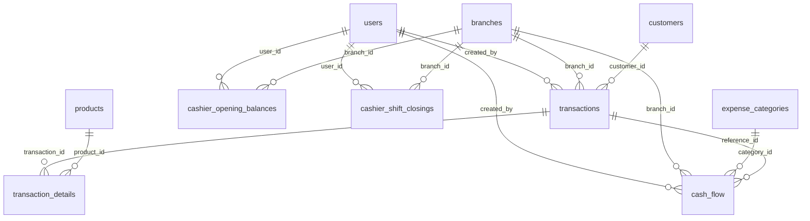

# Bab 3: Referensi Query SQL & Skema Database Kasir

Dokumen ini menyediakan seluruh query SQL standar yang dapat dijalankan langsung di database MySQL / MariaDB (melalui HeidiSQL, phpMyAdmin, Navicat, DBeaver, atau script audit) untuk merekonsiliasi, mengaudit, dan memverifikasi data transaksi kasir **Buku Digital**.

---

## 1. Skema Tabel & Relasi Kasir (SSOT)



| Tabel | Fungsi untuk Kasir | Kolom Kunci yang Digunakan |
| :--- | :--- | :--- |
| `cashier_opening_balances` | Menyimpan modal awal laci kasir per cabang & shift | `business_id`, `branch_id`, `user_id`, `date`, `amount` |
| `transactions` | Seluruh nota penjualan meja & driver delivery | `id`, `business_id`, `branch_id`, `created_by`, `status`, `total_amount`, `payment_method`, `initial_payment_method`, `settlement_payment_method`, `transaction_date` |
| `transaction_details` | Rincian produk dan HPP snapshot | `transaction_id`, `product_id`, `quantity`, `cost_price`, `unit_price`, `total_price` |
| `cash_flow` | Buku besar arus kas masuk & keluar laci/bank | `id`, `business_id`, `branch_id`, `type`, `flow_type`, `reference_type`, `amount`, `payment_method`, `funding_source`, `affects_drawer`, `reference_id`, `date` |
| `cashier_shift_closings` | Rekonsiliasi tutup shift harian & Over/Short | `id`, `business_id`, `branch_id`, `user_id`, `date`, `shift_code`, `expected_drawer_cash`, `actual_cash_counted`, `variance`, `closed_at` |
| `expense_categories` | Klasifikasi beban operasional & HPP | `id`, `name`, `type`, `category_type`, `is_cogs` |

---

## 2. Query 1: Master Rekapitulasi Saldo Laci Kasir (SSOT Dashboard & Laci)

Query ini menghitung saldo kas fisik laci kasir yang diharapkan (*Expected Drawer Cash*) secara 100% konsisten dengan backend:

```sql
SELECT 
    u.id AS cashier_id,
    u.name AS cashier_name,
    b.name AS branch_name,
    CURDATE() AS tanggal,
    
    -- 1. Modal Awal Laci
    COALESCE(modal.modal_awal, 0.00) AS modal_awal_laci,
    
    -- 2. Penjualan Tunai Meja (Langsung Lunas & Status Completed)
    COALESCE(sales.total_penjualan_tunai, 0.00) AS penjualan_tunai_meja,
    COALESCE(sales.jumlah_nota_tunai, 0) AS jumlah_nota_tunai,
    
    -- 3. Pelunasan Kasbon & Setoran Tunai Driver (flow_type = debt_settlement)
    COALESCE(pelunasan.total_pelunasan_tunai, 0.00) AS pelunasan_tunai_masuk,
    COALESCE(pelunasan.jumlah_pelunasan, 0) AS jumlah_pelunasan,
    
    -- TOTAL KAS TUNAI MASUK (CASH INFLOW)
    (
        COALESCE(sales.total_penjualan_tunai, 0.00) + 
        COALESCE(pelunasan.total_pelunasan_tunai, 0.00)
    ) AS TOTAL_CASH_MASUK_HARI_INI,
    
    -- 4. Pengeluaran Kas Fisik dari Laci (Operasional + Es Luar + Handover + Refund)
    COALESCE(pengeluaran.total_pengeluaran_laci, 0.00) AS pengeluaran_tunai_laci,
    COALESCE(pengeluaran.jumlah_pengeluaran, 0) AS jumlah_pengeluaran_laci,
    
    -- EXPECTED DRAWER CASH (SALDO FISIK LACI REAL-TIME)
    (
        COALESCE(modal.modal_awal, 0.00) + 
        COALESCE(sales.total_penjualan_tunai, 0.00) + 
        COALESCE(pelunasan.total_pelunasan_tunai, 0.00) - 
        COALESCE(pengeluaran.total_pengeluaran_laci, 0.00)
    ) AS EXPECTED_DRAWER_CASH,
    
    -- 5. Penerimaan Non-Tunai Langsung (Transfer Bank / DANA - Masuk Rekening Owner)
    COALESCE(nontunai.total_penjualan_non_tunai, 0.00) AS penjualan_non_tunai_bank,
    COALESCE(pelunasan_non_tunai.total_pelunasan_non_tunai, 0.00) AS pelunasan_kasbon_non_tunai

FROM users u
LEFT JOIN branches b ON u.branch_id = b.id

-- Subquery 1: Modal Awal
LEFT JOIN (
    SELECT user_id, SUM(amount) AS modal_awal
    FROM cashier_opening_balances
    WHERE `date` = CURDATE()
    GROUP BY user_id
) modal ON modal.user_id = u.id

-- Subquery 2: Penjualan Tunai Meja (SSOT 100% dari cash_flow: flow_type = sale_direct)
LEFT JOIN (
    SELECT 
        cf.created_by,
        SUM(cf.amount) AS total_penjualan_tunai,
        COUNT(cf.id) AS jumlah_nota_tunai
    FROM cash_flow cf
    WHERE cf.type = 'income'
      AND LOWER(cf.payment_method) = 'cash'
      AND cf.flow_type = 'sale_direct'
      AND cf.affects_drawer = 1
      AND cf.date = CURDATE()
    GROUP BY cf.created_by
) sales ON sales.created_by = u.id

-- Subquery 3: Pelunasan Kasbon & Setoran Driver Tunai (debt_settlement)
LEFT JOIN (
    SELECT 
        cf.created_by,
        SUM(cf.amount) AS total_pelunasan_tunai,
        COUNT(cf.id) AS jumlah_pelunasan
    FROM cash_flow cf
    WHERE cf.type = 'income'
      AND LOWER(cf.payment_method) = 'cash'
      AND cf.affects_drawer = 1
      AND cf.flow_type = 'debt_settlement'
      AND cf.date = CURDATE()
    GROUP BY cf.created_by
) pelunasan ON pelunasan.created_by = u.id

-- Subquery 4: Pengeluaran Kas Fisik dari Laci
LEFT JOIN (
    SELECT 
        cf.created_by,
        SUM(cf.amount) AS total_pengeluaran_laci,
        COUNT(cf.id) AS jumlah_pengeluaran
    FROM cash_flow cf
    WHERE cf.type = 'expense'
      AND LOWER(cf.payment_method) = 'cash'
      AND cf.affects_drawer = 1
      AND cf.flow_type IN ('expense', 'stock_purchase', 'cash_handover', 'cash_refund')
      AND cf.date = CURDATE()
    GROUP BY cf.created_by
) pengeluaran ON pengeluaran.created_by = u.id

-- Subquery 5: Penjualan Non-Tunai Meja
LEFT JOIN (
    SELECT 
        t.created_by,
        SUM(t.total_amount) AS total_penjualan_non_tunai
    FROM transactions t
    WHERE t.type = 'sale'
      AND t.payment_status = 'paid'
      AND LOWER(t.payment_method) != 'cash'
      AND t.status = 'completed'
      AND DATE(t.transaction_date) = CURDATE()
      AND NOT EXISTS (
          SELECT 1 FROM cash_flow cf 
          WHERE cf.reference_id = CAST(t.id AS CHAR) 
            AND cf.reference_type = 'transaction'
            AND cf.flow_type = 'debt_settlement'
      )
    GROUP BY t.created_by
) nontunai ON nontunai.created_by = u.id

-- Subquery 6: Pelunasan Kasbon Non-Tunai
LEFT JOIN (
    SELECT 
        cf.created_by,
        SUM(cf.amount) AS total_pelunasan_non_tunai
    FROM cash_flow cf
    WHERE cf.type = 'income'
      AND LOWER(cf.payment_method) != 'cash'
      AND cf.flow_type = 'debt_settlement'
      AND cf.date = CURDATE()
    GROUP BY cf.created_by
) pelunasan_non_tunai ON pelunasan_non_tunai.created_by = u.id

WHERE u.id = :cashierId;
```

---

## 3. Query 2: Audit Tutup Shift & Selisih Uang Fisik Kasir (Cash Over/Short)

```sql
SELECT 
    csc.id,
    csc.date,
    csc.shift_code,
    b.name AS branch_name,
    u.name AS cashier_name,
    csc.opening_cash,
    csc.cash_sales,
    csc.cash_debt_collection,
    csc.cash_expenses,
    csc.cash_handover_amount,
    csc.cash_refunds,
    csc.expected_drawer_cash,
    csc.actual_cash_counted,
    csc.variance,
    CASE 
        WHEN csc.variance = 0 THEN 'PAS (KLOP)'
        WHEN csc.variance > 0 THEN CONCAT('OVER (+Rp ', FORMAT(csc.variance, 0), ')')
        ELSE CONCAT('SHORT (-Rp ', FORMAT(ABS(csc.variance), 0), ')')
    END AS status_selisih,
    csc.notes,
    csc.closed_at
FROM cashier_shift_closings csc
JOIN users u ON csc.user_id = u.id
JOIN branches b ON csc.branch_id = b.id
WHERE csc.date = CURDATE()
ORDER BY csc.closed_at DESC;
```

---

## 4. Query 3: Audit Contra-Entry Pembatalan Nota (Void Transactions)

```sql
SELECT 
    t.id AS transaction_id,
    t.transaction_date,
    t.total_amount,
    t.payment_method,
    t.status,
    t.void_reason,
    u_void.name AS voided_by_name,
    t.voided_at,
    cf.id AS refund_cash_flow_id,
    cf.amount AS refund_amount,
    cf.flow_type,
    cf.affects_drawer
FROM transactions t
LEFT JOIN users u_void ON t.voided_by = u_void.id
LEFT JOIN cash_flow cf ON cf.reference_id = CAST(t.id AS CHAR) 
                      AND cf.flow_type = 'cash_refund'
WHERE t.status = 'cancelled'
  AND DATE(t.transaction_date) = CURDATE();
```

---

## 5. Definisi SQL Database View: `v_cashier_shift_drawer_summary`

View ini digunakan untuk integrasi sistem checksheet ACS dan audit terpusat:

```sql
CREATE OR REPLACE VIEW v_cashier_shift_drawer_summary AS
SELECT 
    ad.date,
    b.id AS branch_id,
    b.code AS branch_code,
    b.name AS branch_name,
    b.is_main,
    COALESCE(oc.opening_cash, 0.00) AS opening_cash,
    COALESCE(cs.total_cash_sales, 0.00) AS total_cash_sales,
    COALESCE(dc.total_cash_debt_collection, 0.00) AS total_cash_debt_collection,
    COALESCE(ex.total_cash_expenses, 0.00) AS total_cash_expenses,
    (
        COALESCE(oc.opening_cash, 0.00) + 
        COALESCE(cs.total_cash_sales, 0.00) + 
        COALESCE(dc.total_cash_debt_collection, 0.00) - 
        COALESCE(ex.total_cash_expenses, 0.00)
    ) AS expected_drawer_cash,
    COALESCE(cs.cash_sales_count, 0) AS cash_sales_count,
    COALESCE(dc.debt_collection_count, 0) AS debt_collection_count,
    COALESCE(ex.expenses_count, 0) AS expenses_count
FROM (
    SELECT branch_id, `date` FROM cashier_opening_balances WHERE branch_id IS NOT NULL
    UNION
    SELECT branch_id, DATE(`date`) AS `date` FROM cash_flow WHERE branch_id IS NOT NULL AND `date` IS NOT NULL
) ad
JOIN branches b ON b.id = ad.branch_id
LEFT JOIN (
    SELECT branch_id, `date`, SUM(amount) AS opening_cash
    FROM cashier_opening_balances
    GROUP BY branch_id, `date`
) oc ON oc.branch_id = ad.branch_id AND oc.date = ad.date
LEFT JOIN (
    SELECT 
        cf.branch_id, 
        DATE(cf.date) AS `date`,
        SUM(cf.amount) AS total_cash_sales,
        COUNT(cf.id) AS cash_sales_count
    FROM cash_flow cf
    WHERE cf.type = 'income'
      AND LOWER(cf.payment_method) = 'cash'
      AND cf.flow_type = 'sale_direct'
      AND cf.affects_drawer = 1
    GROUP BY cf.branch_id, DATE(cf.date)
) cs ON cs.branch_id = ad.branch_id AND cs.date = ad.date
LEFT JOIN (
    SELECT 
        cf.branch_id,
        DATE(cf.date) AS `date`,
        SUM(cf.amount) AS total_cash_debt_collection,
        COUNT(cf.id) AS debt_collection_count
    FROM cash_flow cf
    WHERE cf.type = 'income'
      AND LOWER(cf.payment_method) = 'cash'
      AND cf.flow_type = 'debt_settlement'
      AND cf.affects_drawer = 1
    GROUP BY cf.branch_id, DATE(cf.date)
) dc ON dc.branch_id = ad.branch_id AND dc.date = ad.date
LEFT JOIN (
    SELECT 
        cf.branch_id,
        DATE(cf.date) AS `date`,
        SUM(cf.amount) AS total_cash_expenses,
        COUNT(cf.id) AS expenses_count
    FROM cash_flow cf
    WHERE cf.type = 'expense'
      AND LOWER(cf.payment_method) = 'cash'
      AND cf.affects_drawer = 1
      AND cf.flow_type IN ('expense', 'stock_purchase', 'cash_handover', 'cash_refund')
    GROUP BY cf.branch_id, DATE(cf.date)
) ex ON ex.branch_id = ad.branch_id AND ex.date = ad.date
WHERE b.is_active = 1;
```
