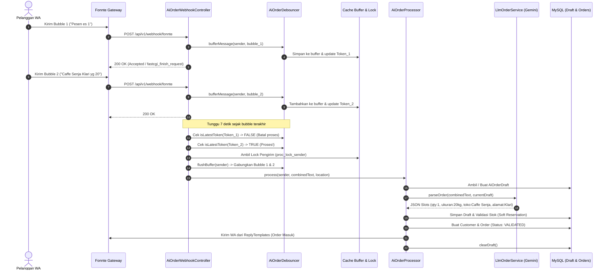

# DOKUMENTASI SISTEM PEMESANAN WHATSAPP BERBASIS AI (BUKUDIG - ADIN CRYSTAL)

Dokumentasi ini menyajikan panduan arsitektur komprehensif, alur logika teknis, integrasi LLM Gemini, mekanisme draft state, sistem debouncing tanpa queue worker, template balasan terpusat, dan konfigurasi lingkungan untuk modul **AI WhatsApp Order System** pada aplikasi POS BukuDig (Distributor Agen Es Kristal Adin Crystal).

---

## DAFTAR ISI
1. [Project Overview](#1-project-overview)
2. [Tech Stack & Dependencies](#2-tech-stack--dependencies)
3. [Arsitektur Baru & Alur Sistem (Sequence Diagram)](#3-arsitektur-baru--alur-sistem-sequence-diagram)
4. [Mekanisme Debounce 7 Detik Tanpa Queue Worker](#4-mekanisme-debounce-7-detik-tanpa-queue-worker)
5. [Draft State & Skema `ai_order_drafts`](#5-draft-state--skema-ai_order_drafts)
6. [State Machine Pesanan Kasir (Order Lifecycle)](#6-state-machine-pesanan-kasir-order-lifecycle)
7. [Integrasi LLM Gemini (`LlmOrderService`)](#7-integrasi-llm-gemini-llmorderservice)
   - [Model Pinning & Latensi Riil](#model-pinning--latensi-riil)
   - [Ekstraksi Slot JSON Murni](#ekstraksi-slot-json-murni)
   - [Penegakan Ukuran Produk Resmi (Hanya 20kg, 15kg, 10kg)](#penegakan-ukuran-produk-resmi-hanya-20kg-15kg-10kg)
   - [Validasi Stok Real-Time & Soft Reservation](#validasi-stok-real-time--soft-reservation)
   - [Fallback Parser Heuristik (Regex Guard)](#fallback-parser-heuristik-regex-guard)
8. [Tabel Template Balasan WhatsApp (PHP Engine)](#8-tabel-template-balasan-whatsapp-php-engine)
9. [Fitur BATAL, UBAH & Share Location](#9-fitur-batal-ubah--share-location)
10. [Konfigurasi Environment (.env) & Variabel Baru](#10-konfigurasi-environment-env--variabel-baru)
11. [Troubleshooting & Panduan Pengujian (Testing)](#11-troubleshooting--panduan-pengujian-testing)

---

## 1. Project Overview

**BukuDig AI WhatsApp Order System** adalah modul pemesanan otomatis terintegrasi yang melayani pelanggan agen es kristal **Adin Crystal** via WhatsApp Gateway (Fonnte). Sistem ini memanfaatkan kombinasi Google Gemini AI dan template PHP deterministik untuk mengubah chat bebas pelanggan menjadi draft transaksi terstruktur yang langsung masuk ke antrean kasir POS secara *real-time*.

### Masalah Produksi yang Telah Diselesaikan:
1. **Pesan Terpecah (Split Bubbles)**: Pelanggan sering mengirim 4-7 bubble chat terpisah dalam hitungan detik. Kini ditangani melalui sistem **Debounce 7 Detik** sehingga seluruh pesan digabung menjadi satu konteks utuh sebelum diproses.
2. **Bot Stateless & Kehilangan Konteks**: Diterapkan tabel **`ai_order_drafts`** sehingga slot pesanan (qty, ukuran, nama toko, alamat, lokasi) disimpan bertahap dan slot yang sudah terisi tidak pernah ditimpa kosong.
3. **Balasan Lambat & Inkonsisten**: Balasan ke pelanggan tidak lagi dibuat oleh LLM, melainkan dirakit secepat kilat oleh **PHP ReplyTemplates**. Gemini hanya bertugas mengekstrak slot data ke JSON murni.
4. **Pesan Grup WhatsApp**: Pesan grup (`isgroup = true` atau berakhiran `@g.us`) difilter seketika di gerbang controller tanpa logging payload berat.
5. **Dukungan Share Location**: Pelanggan dapat mengirim pin lokasi WhatsApp untuk mengisi alamat pengiriman secara instan.

---

## 2. Tech Stack & Dependencies

| Komponen | Spesifikasi / Layanan | Peran & Catatan |
| :--- | :--- | :--- |
| **Backend Framework** | Laravel 11.x (PHP 8.2 / 8.3) | Routing API, MVC, Eloquent ORM, Cache Lock |
| **WhatsApp Gateway** | Fonnte API (`https://api.fonnte.com/send`) | Webhook Receiver & Gateway Pengiriman Pesan |
| **AI Engine (LLM)** | Google Gemini API (`gemini-flash-latest`) | Ekstraksi slot JSON (NLU) |
| **Database** | MySQL 8.x / MariaDB | Tabel `customers`, `customer_phones`, `temporary_orders`, `ai_order_drafts`, `products`, `inventory` |
| **Cache Engine** | Database / File Cache | Debounce buffer, atomic idempotency lock, human handoff mode |
| **POS Frontend** | Blade + AlpineJS / TailwindCSS | Polling antrean pesanan tervalidasi (`/api/v1/kasir/ai-orders`) |

---

## 3. Arsitektur Baru & Alur Sistem (Sequence Diagram)



---

## 4. Mekanisme Debounce 7 Detik Tanpa Queue Worker

Pada lingkungan hosting cPanel/shared hosting tanpa supervisor daemon (`php artisan queue:work`), proses debouncing dijalankan secara aman melalui mekanisme **Versioned Token Buffer** dan **After-Response FastCGI**:

### Cara Kerja:
1. Setiap pesan masuk disimpan ke array buffer pada Cache (`debounce_buffer_{sender}`) bersama token acak terbaru (`debounce_token_{sender}`).
2. **Pola After-Response**:
   - Jika server web mendukung `fastcgi_finish_request()` (PHP-FPM/cPanel), server langsung mengirimkan HTTP 200 OK ke Fonnte (`response()->send(); fastcgi_finish_request();`). Koneksi HTTP ditutup sehingga Fonnte **tidak pernah mengalami timeout atau retry**.
   - Proses PHP di latar belakang tidur selama jeda debounce (`sleep($debounceSeconds)`). Default adalah **7 detik** (`AI_ORDER_DEBOUNCE_SECONDS=7`). Untuk pesan cepat seperti **BATAL** atau **UBAH**, debounce dipersingkat menjadi **2 detik**.
3. **Pemeriksaan Token**:
   - Setelah bangun, script memeriksa apakah token dirinya masih cocok dengan token terbaru di cache.
   - Bila pelanggan mengirim bubble baru selama masa tidur, token di cache telah berubah. Proses lama akan berhenti secara diam-diam (*superseded*).
   - Hanya proses dari **bubble terakhir** yang tokennya cocok, yang akan mengakuisisi lock pengirim, mengosongkan buffer, menggabungkan seluruh teks pesan, dan memprosesnya ke AI.
4. **Human Handoff Bypassing**:
   - Pesan yang mengandung kata `"admin"` atau pengirim yang sedang dalam masa *human mode* **tidak didebounce**, melainkan langsung dieksekusi detik itu juga.

---

## 5. Draft State & Skema `ai_order_drafts`

Tabel `ai_order_drafts` menjamin bot memiliki ingatan percakapan (*stateful*). Jika pelanggan mengirim pesanan tanpa menyebutkan nama toko, pesanan disimpan di draft, dan bot hanya menanyakan nama toko/alamat.

### Struktur Tabel `ai_order_drafts`:
```sql
CREATE TABLE ai_order_drafts (
    id BIGINT UNSIGNED AUTO_INCREMENT PRIMARY KEY,
    sender_phone VARCHAR(50) NOT NULL UNIQUE,
    data JSON NULL,
    awaiting VARCHAR(50) NULL,
    last_message_at TIMESTAMP NULL,
    expires_at TIMESTAMP NULL,
    created_at TIMESTAMP NULL,
    updated_at TIMESTAMP NULL,
    INDEX (sender_phone)
);
```

### Format JSON pada Kolom `data`:
```json
{
  "nama_toko": "Cafe Senja",
  "alamat": "Jl. Merdeka No 10",
  "lat": "-6.2088",
  "lng": "106.8456",
  "jumlah_ball": 3,
  "ukuran_produk": "20kg",
  "waktu_pengiriman": "2026-11-06 16:00:00",
  "is_registration": true
}
```

### Aturan Penggabungan Slot (Slot Merging):
- **Immutabilitas Nilai Terisi**: Slot yang sudah memiliki nilai tidak boleh ditimpa oleh `null` atau string kosong pada pesan berikutnya.
- **Kadaluarsa Otomatis**: Draft memiliki batas waktu inaktivitas 30 menit (`expires_at = now()->addMinutes(30)`). Bila lewat 30 menit tanpa aktivitas, draft di-reset otomatis.

---

## 6. State Machine Pesanan Kasir (Order Lifecycle)

Pesanan pada tabel `temporary_orders` mengikuti siklus hidup yang terdefinisi ketat:

```
[Chat Pelanggan]
       │
       ▼
  [validated] ───────────────► [cancelled] (Pelanggan ketik BATAL)
       │
       ▼ (Kasir drag ke POS / klik Proses)
  [processed]
```

| Status | Arti & Perilaku Sistem |
| :--- | :--- |
| **`validated`** | Pesanan lengkap dan terkonfirmasi. **Langsung tampil di antrean kasir POS**. Pelanggan lama maupun baru yang datanya lengkap langsung berstatus `validated` (tanpa perlu balas "OKE"). Pelanggan masih dapat membatalkan (`BATAL`) atau merevisi (`UBAH`). |
| **`processed`** | Pesanan telah diambil oleh kasir dan dipindahkan ke keranjang transaksi POS (melalui `POST /api/v1/kasir/ai-orders/{id}/processed`). Jika pelanggan chat `BATAL` atau `UBAH`, bot menolak dan membalas template `already_processed`. |
| **`cancelled`** | Pesanan dibatalkan oleh pelanggan sebelum diproses kasir, atau ditandai batal secara manual. Tidak tampil di antrean kasir. |

---

## 7. Integrasi LLM Gemini (`LlmOrderService`)

### Model Pinning & Latensi Riil
- **Model Resmi**: Dipin ke `gemini-flash-latest` (sesuai konfigurasi `.env` staging/produksi). Hindari alias dinamis yang tidak terdaftar.
- **Latensi Produksi**: Log produksi mencatat waktu panggilan Gemini berkisar antara **10 hingga 13 detik**. Oleh karena itu:
  - Timeout HTTP dipersingkat menjadi **8 detik** dengan **1x retry cepat (100ms)**.
  - Jika Gemini timeout atau error, sistem segera beralih ke **Regex Fallback Parser** lokal (< 5ms) tanpa membuat pelanggan menunggu.

### Ekstraksi Slot JSON Murni
Prompt AI dirampingkan secara drastis: AI **dilarang menghasilkan teks sapaan/balasan**. AI hanya bertugas mengisi skema slot JSON:

```json
{
  "nama_toko": "string|null",
  "alamat": "string|null",
  "jumlah_ball": "integer|null",
  "ukuran_produk": "20kg|15kg|10kg|null",
  "waktu_pengiriman": "YYYY-MM-DD HH:MM:SS|null",
  "is_registration": "boolean",
  "unknown_ukuran": "boolean"
}
```

### Penegakan Ukuran Produk Resmi (Hanya 20kg, 15kg, 10kg)
Sistem Adin Crystal **HANYA** mendukung 3 varian ukuran es kristal:
- **`20kg`**: Dipicu oleh istilah `"yang 19"`, `"19rb"`, `"19k"`, `"20kg"`, `"20"`, atau ukuran tidak disebut.
- **`15kg`**: Dipicu oleh `"yang 15"`, `"15rb"`, `"15k"`, `"15kg"`, `"15"`.
- **`10kg`**: Dipicu oleh `"yang 10"`, `"10rb"`, `"10k"`, `"10kg"`, `"10"`.
- **Ukuran Tidak Dikenal (Contoh: "yang 5", "5kg")**: **DILARANG KERAS** dipetakan ke ukuran mana pun. Sistem menandai `unknown_ukuran = true`, mengosongkan slot ukuran, dan mengirimkan balasan template `unknown_ukuran`.

### Validasi Stok Real-Time & Soft Reservation
Pengecekan stok dilakukan sebelum pesanan disetujui:
$$\text{Stok Tersedia} = \text{Stok Fisik Gudang} - \sum (\text{Ball Pesanan Validated Hari Ini Belum Diproses})$$

- **Dual-Layer Guard**: Jika LLM lolos menghasilkan pesanan melebihi stok, guard level PHP (`isStockExceeded`) langsung mencegatnya.
- **Kebijakan Kerahasiaan Angka**: Sistem **DILARANG** menyebutkan sisa angka stok aktual kepada pelanggan. Dilengkapi `filterStockNumbers` yang menyaring angka sisa gudang dari teks balasan.

### Fallback Parser Heuristik (Regex Guard)
Bila koneksi internet/Gemini terputus, parser regex lokal mengambil alih dengan aturan cermat:
- Angka yang didahului `"jam"` (contoh: `"jam 10"`, `"jam 15"`) **BUKAN ukuran**, melainkan jam pengiriman.
- Angka yang diikuti `"ball"` (contoh: `"10 ball"`) **BUKAN ukuran**, melainkan jumlah ball.
- Konteks draft tidak dibuang, melainkan diperbarui secara deterministik.

---

## 8. Tabel Template Balasan WhatsApp (PHP Engine)

Seluruh pesan balasan ke pelanggan dihasilkan secara instan oleh `App\Services\Ai\ReplyTemplates`. Nama bisnis selalu **"Adin Crystal"**. Panjang balasan dibatasi maksimal 2–3 baris tanpa *footer* statis berulang.

| Kunci Template | Isi Pesan Template | Pemicu / Kondisi |
| :--- | :--- | :--- |
| `greeting` | `Halo Kak, saya asisten otomatis Adin Crystal. Langsung ketik aja, contoh: 3 ball yang 20 jam 4 sore`<br>`(Ketik *admin* untuk bicara dengan staf)` | Chat hanya sapaan ("halo", "p") tanpa rincian order. |
| `need_name_address` | `Siap, {qty} ball {ukuran}. Tinggal nama toko & alamat (atau share lokasi) ya.` | Pelanggan baru memesan tapi belum mencantumkan nama toko / alamat. |
| `need_qty` | `Mau berapa ball? Ukuran 20 / 15 / 10 kg?` | Pelanggan menyebut toko/ukuran tanpa menyebut kuantitas. |
| `need_ukuran` | `Ukuran berapa Kak? 20 / 15 / 10 kg?` | Kuantitas ada tetapi ukuran belum jelas. |
| `unknown_ukuran` | `Ukuran yang tersedia 20 / 15 / 10 kg. Mau yang mana Kak?` | Pelanggan menyebut ukuran yang tidak didukung (misal "yang 5"). |
| `order_in_existing` | `✅ Pesanan masuk: {qty} ball {ukuran} -> {nama_toko}{, jam HH:mm}.`<br>`Salah? Balas *BATAL* atau *UBAH*.` | Pesanan pelanggan lama lengkap (langsung masuk antrean kasir). |
| `order_in_new` | `✅ Terdaftar & pesanan masuk: {qty} ball {ukuran} -> {nama_toko}, {alamat}.`<br>`Salah? Balas *BATAL* atau *UBAH*.` | Pendaftaran dan pesanan pelanggan baru berhasil (One-Step). |
| `order_in_kasbon` | `Ada kasbon Rp {nominal}, titip ke supir saat pengiriman ya.` | Baris tambahan otomatis jika pelanggan memiliki tunggakan kasbon. |
| `out_of_stock` | `Maaf Kak, stok ukuran itu belum cukup untuk jumlah segitu. Kurangi jumlahnya atau ketik *admin*.` | Jumlah pesanan melebihi stok gudang (tanpa membocorkan angka). |
| `cancelled` | `Pesanan dibatalkan. Mau pesan lagi? Langsung ketik aja.` | Pelanggan membalas "BATAL" pada pesanan berstatus validated. |
| `already_processed` | `Pesanan sudah diproses kasir. Ketik *admin* untuk perubahan.` | Pelanggan ingin batal/ubah padahal pesanan sudah diproses kasir. |
| `location_only` | `Lokasi diterima 📍 Mau pesan berapa ball & ukuran berapa?` | Pelanggan mengirim share location WhatsApp tanpa teks pesanan. |
| `unsupported_media` | `Maaf, saya hanya bisa baca teks dan lokasi.` | Pelanggan mengirim audio/video/dokumen tanpa teks atau lokasi. |
| `ubah_prompt` | `Oke, ketik perubahannya aja, contoh: jadi 3 ball.` | Pelanggan membalas "UBAH" pada pesanan validated. |

---

## 9. Fitur BATAL, UBAH & Share Location

### Logika BATAL:
- Pelanggan mengirim kata kunci `"batal"` atau `"cancel"` (pesan pendek).
- Sistem memeriksa pesanan terakhir hari ini. Jika berstatus `validated`, status diubah menjadi `cancelled`, draft dibersihkan, dan dibalas konfirmasi pembatalan.

### Logika UBAH:
- Pelanggan membalas `"ubah"` atau `"ganti"`.
- Sistem membuka kembali draft dari data pesanan aktif terakhir dan mengirim prompt: *"Oke, ketik perubahannya aja, contoh: jadi 3 ball."*
- Chat berikutnya (contoh: `"jadi 4 ball"`) di-merge ke draft, lalu sistem **memperbarui pesanan yang sama** (tidak membuat order duplikat).

### Logika Pesan Susulan (Follow-up) & Jendela Ack:
- **Jendela Pesan Susulan (`AI_ORDER_FOLLOWUP_MINUTES=5`)**:
  - Jika pelanggan mengirim pesan penegasan/perubahan (misalnya *"yang 20kg"*, *"yg 15kg"*, *"2 ball"*, *"tambah 1"*) dalam 5 menit setelah order tercatat:
    - **Nilai Sama**: Balas template pengakuan (*"Siap Kak, pesanan tetap {qty} ball {ukuran} 👍"*), database tidak diubah.
    - **Nilai Beda**: Update order berjalan, cek stok, dan balas konfirmasi baru dengan reminder BATAL/UBAH.
    - **Order Sudah Diproses Kasir (`processed`)**: Balas template penolakan (*"Pesanan sudah diproses kasir. Ketik \*admin\* untuk perubahan."*).
- **Jendela Pengakuan / Ack (`AI_ORDER_ACK_MINUTES=10`)**:
  - Kata sopan/pengakuan seperti *"oke"*, *"ok"*, *"siap"*, *"iya"*, *"makasih"*, *"terima kasih"*, *"sip"* dalam 10 menit setelah order tidak akan memicu pertanyaan ulang (*"Mau berapa ball?"*), melainkan dibalas santun (*"Siap Kak 👍"*) atau diam (`AI_ORDER_ACK_REPLY=true/false`).
- **Di Luar Jendela (> 5 menit)**:
  - Pesan ukuran saja seperti *"yang 20kg"* akan membuka alur pesanan baru secara wajar (menanyakan jumlah ball).

### Notifikasi Grup WhatsApp Admin (Fonnte):
Sistem dapat mengirimkan peringatan instan ke grup WhatsApp internal toko (`AI_ORDER_ADMIN_GROUP_ID`, format `...@g.us`):
1. **Human Mode**: `🔔 [HUMAN MODE] Pelanggan {nama/nomor} meminta bantuan admin. Pesan: "{pesan}"`
2. **Pelanggan Baru**: `🆕 [PELANGGAN BARU] {nama_toko} ({alamat}) order {qty} ball {ukuran}. Status: menunggu kasir.`
3. **Stok Kurang**: `⚠️ [STOK KURANG] Permintaan {qty} ball {ukuran} dari {nama/nomor} melebihi sisa stok.` (angka stok riil dirahasiakan).
4. **Kendala Gemini API**: `⚠️ [SISTEM] Gemini API mengalami kendala, sistem beralih ke regex parser.` (maksimal 1x per 10 menit).
- Anti-spam: Setiap tipe notifikasi memiliki deduplikasi cache maksimal 1 kali per pelanggan per 15 menit.
- Auto-discovery Group ID: Jika `AI_ORDER_ADMIN_GROUP_ID` kosong di `.env`, sistem otomatis mencatat ID grup yang masuk ke log staging 1x per 24 jam agar memudahkan konfigurasi.

### Soft Reservation 24 Jam & Lazy-Expiry:
- Hanya pesanan berstatus `validated` dalam kurun waktu 24 jam terakhir yang memotong alokasi stok sementara gudang.
- Pesanan lama yang belum diselesaikan kasir lebih dari 24 jam otomatis diubah statusnya menjadi `expired` saat antrean atau stok dibaca (Lazy Expiry).
- Kolom boolean `is_new_customer` pada tabel `temporary_orders` diset `true` hanya saat pelanggan baru mendaftar, memudahkan identifikasi kasir.

### Integrasi Share Location:
- Fonnte mengirimkan koordinat pada field payload `location` (format `"latitude,longitude"`).
- Sistem menyimpan latitude dan longitude ke kolom draft. Alamat teks otomatis diisi `"Lokasi WhatsApp"` bila belum ada teks jalan.
- Pada antrean kasir, kasir mendapatkan link otomatis: `https://www.google.com/maps?q={lat},{lng}` untuk panduan supir pengiriman.

---

## 10. Konfigurasi Environment (.env) & Variabel Baru

Semua konfigurasi terpusat pada file `config/ai_order.php` dan dibaca menggunakan helper `config('ai_order.xxx')`. Tambahkan variabel berikut ke file `.env`:

```ini
# ==============================================================
# KONFIGURASI AI WHATSAPP ORDER SYSTEM (BUKUDIG)
# ==============================================================
# Jeda debounce penggabungan bubble chat (detik). Default: 7
AI_ORDER_DEBOUNCE_SECONDS=7

# Menggunakan pola fastcgi/litespeed_finish_request agar Fonnte tidak timeout. Default: true
AI_ORDER_AFTER_RESPONSE=true

# Mode pengujian tanpa mengirim WA riil ke pelanggan (true/false). Default: false
AI_ORDER_DRY_RUN=false

# Batas maksimal pesan per nomor per menit untuk proteksi spam/DDoS. Default: 20
AI_ORDER_RATE_LIMIT=20

# Token rahasia webhook opsional untuk verifikasi header/query Fonnte
FONNTE_WEBHOOK_SECRET=

# Jendela waktu pesan susulan penegasan/perubahan (menit). Default: 5
AI_ORDER_FOLLOWUP_MINUTES=5

# Jendela waktu pengakuan / ucapan terima kasih (menit). Default: 10
AI_ORDER_ACK_MINUTES=10

# Balasan bot terhadap ucapan terima kasih ("Siap Kak 👍"). Default: true
AI_ORDER_ACK_REPLY=true

# ID WhatsApp Group Admin untuk notifikasi sistem (format ...@g.us)
AI_ORDER_ADMIN_GROUP_ID=

# Aktifkan pengiriman notifikasi grup admin. Default: true
AI_ORDER_ADMIN_NOTIFY=true

# ==============================================================
# GOOGLE GEMINI LLM
# ==============================================================
GEMINI_API_KEY=AIzaSyYourGeminiApiKeyHere
GEMINI_MODEL=gemini-flash-latest

# ==============================================================
# WHATSAPP GATEWAY (FONNTE)
# ==============================================================
FONNTE_TOKEN=YourFonnteDeviceTokenHere
FONNTE_API_URL=https://api.fonnte.com/send

# ==============================================================
# CACHE STORE (Disarankan 'database' atau 'redis' untuk shared hosting)
# ==============================================================
CACHE_STORE=database
```

---

## 11. Troubleshooting & Panduan Pengujian (Testing)

### Menjalankan Automated Feature Test:
Test suite komprehensif mencakup 17 skenario pengujian utama berada di `tests/Feature/AiOrderSystemTest.php`:

```bash
# Menjalankan seluruh skenario pengujian AI Order System
php artisan test --filter=AiOrderSystemTest
```

### 17 Skenario Pengujian yang Tercover:
1. **Transkrip Nyata Pelanggan Baru**: Uji coba 4 bubble terpecah yang digabung rapi menjadi 1 pelanggan dan 1 pesanan tervalidasi.
2. **Pesan Tunggal Lengkap (One-Step)**: Registrasi nama toko + alamat sekaligus order 1 langkah.
3. **Pelanggan Lama**: Order langsung berstatus `validated` dan memuat instruksi BATAL/UBAH.
4. **Alur BATAL & UBAH**: Pengujian pembatalan, revisi pesanan tanpa duplikasi, dan penolakan pada order yang sudah diproses kasir.
5. **Guard Stok Ketat**: Penolakan saat pesanan melebihi stok gudang dan verifikasi tidak bocornya angka stok riil.
6. **Filtrasi Pesan Grup**: Pesan `@g.us` diabaikan seketika tanpa menulis ke database.
7. **Idempotensi Retry Fonnte**: Request ganda dengan ID identik diabaikan oleh cache lock.
8. **Share Location WhatsApp**: Koordinat latitude/longitude tersimpan ke draft dan alamat terisi.
9. **Ketahanan Regex Fallback**: Pengujian ketika Gemini API error/timeout, pembedaan `"jam 10"` vs ukuran 10kg, dan penolakan ukuran tidak sah (`"yang 5"`).
10. **Normalisasi Nomor Telepon**: Format `08...`, `628...`, dan `+628...` dipetakan ke record pelanggan tunggal.
11. **Follow-up Ukuran Sama**: Balas "pesanan tetap {qty} ball {ukuran} 👍", database tidak berubah.
12. **Follow-up Qty Berbeda**: Order berjalan ter-update kuantitasnya, memicu balasan konfirmasi baru.
13. **Ack Ucapan Terima Kasih**: "oke" / "makasih" dibalas "Siap Kak 👍" tanpa menanyakan ulang jumlah ball.
14. **Follow-up Di Luar Jendela (> 5 menit)**: Permintaan ukuran diproses sebagai pesanan baru (menanyakan jumlah ball).
15. **Follow-up Order Processed**: Penolakan perubahan pesanan yang sudah diproses kasir.
16. **Soft-reservation 24 Jam & Lazy-Expiry**: Pesan tervalidasi > 24 jam berubah menjadi `expired` dan alokasi stok dilepaskan.
17. **Notifikasi Grup Admin**: Verifikasi pengiriman event Human Mode, Pelanggan Baru, dan Stok Kurang ke grup WhatsApp admin.

### Pemeriksaan Log Produksi & Staging:
Bila terjadi kendala di server staging, periksa log menggunakan:
```bash
tail -n 100 storage/logs/laravel.log | grep "\[AiOrder"
```
Log sistem telah dirancang ringkas dengan penyensoran nomor telepon (`0812****7890`) untuk menjaga privasi pelanggan.
