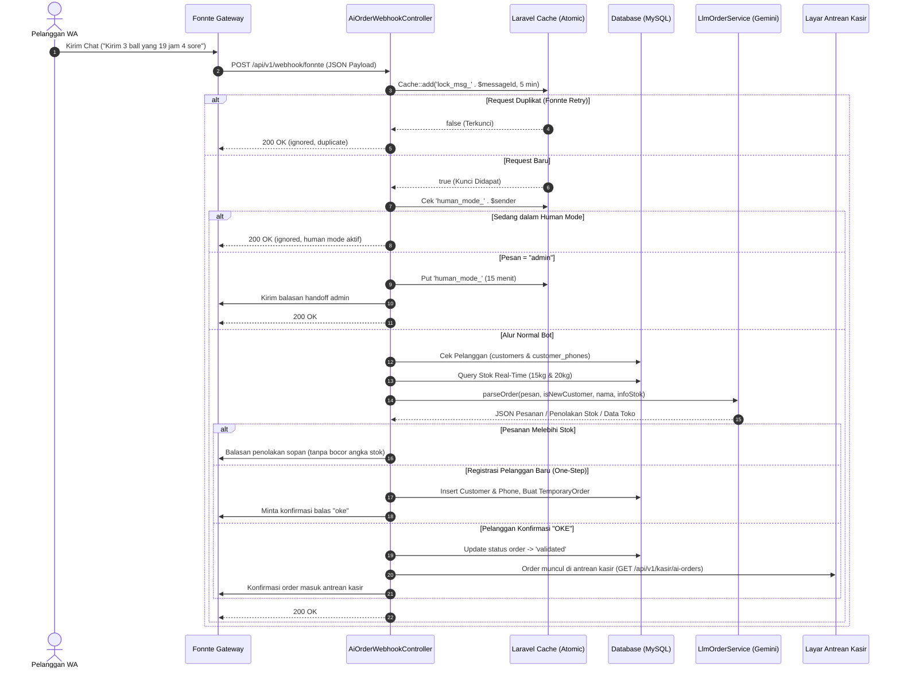
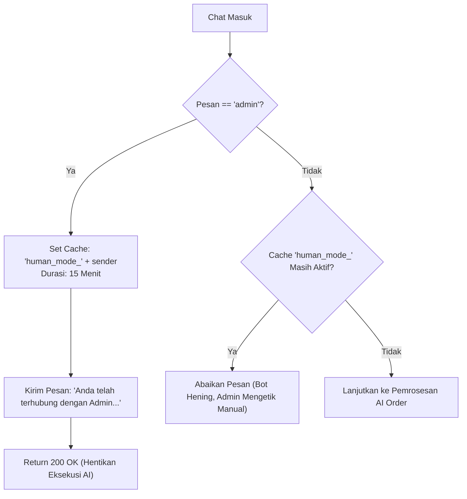

# DOKUMENTASI SISTEM PEMESANAN WHATSAPP BERBASIS AI (BUKUDIG - ADIN CRYSTAL)

Dokumentasi ini menyajikan panduan arsitektur komprehensif, alur logika teknis, integrasi LLM Gemini, mekanisme perlindungan webhook, dan konfigurasi *environment* untuk modul **AI WhatsApp Order System** pada aplikasi POS BukuDig (Distributor Agen Es Kristal Adin Crystal).

---

## DAFTAR ISI
1. [Project Overview](#1-project-overview)
2. [Tech Stack & Dependencies](#2-tech-stack--dependencies)
3. [System Architecture & Alur Utama (Main Flow)](#3-system-architecture--alur-utama-main-flow)
4. [Proteksi Duplikasi Webhook (Atomic Cache Lock)](#4-proteksi-duplikasi-webhook-atomic-cache-lock)
5. [Logika Human Handoff (Admin Mode)](#5-logika-human-handoff-admin-mode)
6. [Core Service & Integrasi AI (LlmOrderService)](#6-core-service--integrasi-ai-llmorderservice)
   - [Dynamic System Prompt Construction](#dynamic-system-prompt-construction)
   - [Validasi Stok Real-Time & Kebijakan Privasi Angka](#validasi-stok-real-time--kebijakan-privasi-angka)
   - [One-Step Auto-Registration Pelanggan Baru](#one-step-auto-registration-pelanggan-baru)
   - [Pemetaan Ukuran Produk Wajib (Normalizer)](#pemetaan-ukuran-produk-wajib-normalizer)
7. [Mekanisme Cadangan (Regex Fallback Parser)](#7-mekanisme-cadangan-regex-fallback-parser)
8. [Format UI/UX & Pesan Balasan WhatsApp](#8-format-uiux--pesan-balasan-whatsapp)
9. [Integrasi Antrean Kasir (POS Integration)](#9-integrasi-antrean-kasir-pos-integration)
10. [Konfigurasi Environment (.env) & Deployment](#10-konfigurasi-environment-env--deployment)

---

## 1. Project Overview

**BukuDig AI WhatsApp Order System** adalah modul cerdas yang dirancang untuk mengotomatisasi penerimaan pesanan es kristal melalui WhatsApp Gateway (Fonnte). Sistem ini memanfaatkan Large Language Model (LLM) Google Gemini untuk mengurai percakapan bahasa alami pelanggan, mengekstrak niat pemesanan, melakukan validasi ketersediaan stok aktual, mendaftarkan toko pelanggan baru secara otomatis, dan menyajikan pesanan terkonfirmasi langsung ke layar antrean kasir POS secara *real-time*.

### Tujuan Utama:
1. **Mengurangi Beban Kasir/Admin**: Meniadakan kebutuhan pengetikan manual untuk setiap chat WhatsApp yang masuk.
2. **Eliminasi Human Error**: Normalisasi ukuran produk (misal: "yang 19" dipetakan otomatis ke 20kg), ekstraksi jumlah karung/ball secara presisi, serta parsing waktu pengiriman.
3. **Pendaftaran Otomatis (Zero-Friction Onboarding)**: Pelanggan baru dapat langsung mendaftarkan nama toko dan alamat dalam satu kalimat pesanan.
4. **Proteksi Stok & Integritas Bisnis**: Mencegah *overselling* tanpa membeberkan angka stok gudang yang sensitif kepada pelanggan.

---

## 2. Tech Stack & Dependencies

| Komponen | Teknologi / Layanan | Fungsi & Keterangan |
| :--- | :--- | :--- |
| **Backend Framework** | Laravel 10.x / 11.x (PHP 8.2+) | MVC Core, Routing API, Database Eloquent ORM |
| **WhatsApp Gateway** | Fonnte API (`https://api.fonnte.com/send`) | Webhook Receiver & REST API Pengiriman Pesan WA |
| **AI Engine (LLM)** | Google Gemini API (`gemini-flash-latest`) | Ekstraksi JSON pesanan, NLU bahasa santai/gaul, registrasi data toko |
| **Database** | MySQL 8.x / MariaDB | Relasi `customers`, `customer_phones`, `temporary_orders`, `products`, `inventories` |
| **Cache & Locking** | Laravel Cache Engine (Atomic Lock) | Idempotensi webhook, isolasi Human Admin mode 15 menit |
| **POS Kasir UI** | Blade + AlpineJS / TailwindCSS / Fetch API | Tampilan antrean pesanan tervalidasi yang siap diproses kasir |

---

## 3. System Architecture & Alur Utama (Main Flow)

Sistem beroperasi melalui arsitektur berbasis webhook sinkron dengan proteksi kunci atomik.



---

## 4. Proteksi Duplikasi Webhook (Atomic Cache Lock)

### Latar Belakang Masalah
Fonnte memiliki mekanisme *retry* agresif: jika server backend tidak merespons dalam waktu 4-5 detik (misalnya karena latensi jaringan saat memanggil Gemini API), Fonnte akan mengirimkan payload webhook yang sama berulang kali. Kondisi ini dapat memicu:
- Pesanan tercatat ganda pada tabel `temporary_orders`.
- Pengiriman balasan WhatsApp berulang kali ke pelanggan (*spamming*).

### Mengapa Tidak Menggunakan Laravel Queue/Jobs?
Penggunaan Laravel Queue sempat diuji, namun diputuskan untuk **dibatalkan (revert)** karena:
1. **Serialization Issue**: Payload webhook mentah sering mengandung karakter non-UTF8 atau struktur nested yang memicu *PHP serialization exception* pada worker.
2. **Keterbatasan Shared/cPanel Hosting**: Lingkungan produksi tidak selalu menjalankan supervisor background worker (`php artisan queue:work`) secara persisten.
3. **User Experience**: Pesanan WA membutuhkan respon dialog seketika (interaktif langsung).

### Solusi Terpilih: Atomic Cache Lock
Digunakan metode `Cache::add()` yang bersifat atomik di baris pertama controller:

```php
// File: app/Http/Controllers/Api/V1/AiOrderWebhookController.php

$timestamp = $payload['timestamp'] ?? time();
$senderRaw = $payload['sender'] ?? $payload['from'] ?? '';
$messageId = $timestamp . '_' . $senderRaw;

// Cache::add bersifat atomik (menghasilkan true hanya jika key belum pernah ada).
// Retry berulang dari Fonnte dengan messageId yang sama akan bernilai false dan langsung dihentikan.
if (!Cache::add('lock_msg_' . $messageId, true, now()->addMinutes(5))) {
    Log::info("[AiOrderWebhook] Duplicate webhook request ignored: {$messageId}");
    return response()->json(['status' => 'ignored', 'message' => 'Duplicate webhook request']);
}
```

---

## 5. Logika Human Handoff (Admin Mode)

Ketika pelanggan membutuhkan bantuan khusus di luar kemampuan bot (misal: komplain pesanan, negosiasi harga khusus, atau pertanyaan teknis), pelanggan dapat beralih ke Admin Manusia.



### Implementasi Teknis:
- **Keyword Pemicu**: Kata `admin` (case-insensitive).
- **Durasi Kunci**: 15 Menit (`now()->addMinutes(15)`).
- **Perilaku Bot**: Selama kunci ini aktif, bot tidak akan merespons chat apapun dari nomor tersebut, memberi kebebasan penuh kepada admin manusia untuk berdialog melalui aplikasi WhatsApp resmi tanpa interupsi AI.

---

## 6. Core Service & Integrasi AI (`LlmOrderService`)

Service `App\Services\Ai\LlmOrderService` bertindak sebagai *brain* yang mengubah teks bebas menjadi objek JSON terstruktur.

### Dynamic System Prompt Construction
System prompt tidak statis, melainkan dirakit secara dinamis sebelum panggilan API:
1. **Waktu Server Riil**: Format WIB (`Asia/Jakarta`) diinjeksikan agar AI mengetahui konsep "hari ini", "besok", "sore", atau "siang".
2. **Status Pelanggan**:
   - Jika `$isNewCustomer === true`: Diinstruksikan untuk tidak memproses pesanan sebelum mendapatkan Nama Toko dan Alamat.
   - Jika `$isNewCustomer === false`: Diinstruksikan untuk memproses pesanan dan meminta konfirmasi kata "oke".
3. **Informasi Stok Aktual**: Diinjeksikan ke dalam header prompt: `INFORMASI STOK SAAT INI: Stok 15kg: X ball. Stok 20kg: Y ball.`

---

### Validasi Stok Real-Time & Kebijakan Privasi Angka

Salah satu fitur paling krusial adalah **perlindungan privasi bisnis**: AI wajib mengetahui sisa stok aktual untuk mencegah pesanan fiktif, tetapi **DILARANG KERAS** memberi tahu pelanggan berapa sisa stok di gudang.

```text
ATURAN VALIDASI STOK (System Prompt):
PENTING: Sebelum memproses pesanan, bandingkan jumlah pesanan dengan INFORMASI STOK SAAT INI. 
Jika pesanan MELEBIHI sisa stok, JANGAN kembalikan format JSON pesanan. 
Tolak pesanan dengan sopan, TETAPI KAMU DILARANG KERAS MENYEBUTKAN ANGKA SISA STOK AKTUAL KEPADA PELANGGAN. 
Gunakan bahasa yang natural seperti: 
'Maaf Kak, kebetulan stok es ukuran tersebut saat ini sedang kurang dari permintaan Kakak.' 
Di akhir kalimat WAJIB tambahkan: 
'Silakan kurangi jumlah pesanan, atau ketik *admin* agar kami dapat mengecek jadwal produksi selanjutnya.'
```

#### Dual-Layer Stock Guard (PHP Fallback):
Bila LLM secara tidak sengaja mengembalikan JSON meskipun stok tidak cukup, controller dan service memiliki lapisan verifikasi kedua pada level PHP (`isStockExceeded()`):
```php
if ($this->isStockExceeded($jumlahBall, $ukuranProduk, $infoStok, $availableStock)) {
    return [
        'is_out_of_stock' => true,
        'reply' => "Maaf {$customerName}, kebetulan stok es ukuran tersebut saat ini sedang kurang dari permintaan Kakak. Silakan kurangi jumlah pesanan, atau ketik *admin* agar kami dapat mengecek jadwal produksi selanjutnya.",
    ];
}
```

---

### One-Step Auto-Registration Pelanggan Baru

Untuk memangkas friksi pelanggan baru, sistem mendukung pendaftaran dan pemesanan sekaligus dalam 1 pesan WhatsApp (One-Step Registration).

#### Contoh Pesan Pelanggan:
> *"Halo saya dari Cafe Senja Kopi alamat Jl. Merdeka No 45 mau pesan es kristal 4 ball yang 19 kirim jam 3 sore ya"*

#### Output JSON dari Gemini:
```json
{
  "is_registration": true,
  "nama_toko": "Cafe Senja Kopi",
  "alamat": "Jl. Merdeka No 45",
  "jumlah_ball": 4,
  "ukuran_produk": "20kg",
  "waktu_pengiriman": "2026-11-06 15:00:00"
}
```

#### Aksi Otomatis di Controller:
1. Menyimpan data toko ke tabel `customers` (`name`, `phone`, `address`, `status = 'active'`).
2. Menghubungkan nomor telepon ke relasi `customer_phones` (`is_primary = true`).
3. Membuat record pesanan di `temporary_orders` dengan `status = 'pending'`.
4. Mengirim balasan:
   > *"Data toko berhasil didaftarkan! Pesanan Anda: 4 ball 20kg. Balas 'oke' untuk konfirmasi masuk antrean kasir."*

---

### Pemetaan Ukuran Produk Wajib (Normalizer)

Pelanggan es kristal sering menggunakan bahasa harga lama untuk menyebutkan ukuran fisik es. Sistem menerapkan standardisasi otomatis:

| Istilah Chat Pelanggan | Dipetakan Menjadi (`ukuran_produk`) | Alasan / Catatan |
| :--- | :---: | :--- |
| `"yang 19"`, `"19rb"`, `"19k"`, `"19"`, `"20kg"` | **`20kg`** | Es Kristal ukuran standar 20 kg (harga asosiasi 19 ribu) |
| `"yang 15"`, `"15rb"`, `"15k"`, `"15"`, `"15kg"` | **`15kg`** | Es Kristal ukuran sedang 15 kg |
| `"yang 10"`, `"10rb"`, `"10k"`, `"10"`, `"10kg"` | **`10kg`** | Es Kristal ukuran kecil 10 kg |
| *(Tidak menyebutkan ukuran)* | **`20kg`** | Standar *default* pabrik Adin Crystal |

---

## 7. Mekanisme Cadangan (Regex Fallback Parser)

Bila terjadi kendala teknis pada layanan eksternal (misalnya Gemini API mengalami Error HTTP 400 Invalid Key, Error 429 Quota Exceeded, atau Timeout 60 detik), sistem **tidak akan crash**, melainkan otomatis mengalihkan ke fungsi internal `heuristicFallbackParser()`:

```php
// File: app/Services/Ai/LlmOrderService.php
try {
    $rawResponse = $this->callGeminiApi($systemPrompt, $chatMessage);
    // ... decode dan validasi JSON ...
} catch (\Throwable $e) {
    Log::error("[LlmOrderService] Gagal memanggil Gemini API: " . $e->getMessage());
    return $this->heuristicFallbackParser($chatMessage, $isNewCustomer, $customerName, $infoStok);
}
```

### Logika Regex Fallback:
1. **Deteksi Ukuran**: Mencari regex pattern `/(?:^|\D)(19|15|10)(?:rb|k)?(?:\D|$)/i`.
2. **Deteksi Kuantitas**: Mencari pola `(\d+)\s*(?:ball|karung|sak|bungkus|pack|biji)`. Jika angka 19/15/10 muncul tanpa penanda ball, angka tersebut diposisikan sebagai ukuran, bukan kuantitas.
3. **Deteksi Waktu**: Mencari format jam `jam\s*(\d{1,2})(?::(\d{2}))?\s*(pagi|siang|sore|malam)?` dan menghitung waktu datetime secara otomatis.

### Perbandingan: AI vs Regex Fallback

| Aspek | AI (Google Gemini NLU) | Regex Heuristic Fallback |
| :--- | :--- | :--- |
| **Fleksibilitas Bahasa** | Sangat Tinggi: Memahami slang, typo, singkatan, kalimat kompleks bertingkat. | Terbatas: Hanya mendeteksi kata kunci yang terdaftar dalam pola regex. |
| **Ekstraksi Alamat** | Sangat Pintar: Mampu membedakan nama toko, patokan jalan, dan nomor rumah. | Dasar: Hanya memotong string jika mengandung kata penanda "alamat/jalan". |
| **Kecepatan Respons** | 1.5 – 3.5 detik (tergantung jaringan ke Google). | < 5 milidetik (komputasi lokal memori PHP). |
| **Ketergantungan** | Butuh koneksi internet & token API aktif. | 100% Berjalan offline di server internal. |

---

## 8. Format UI/UX & Pesan Balasan WhatsApp

### 1. Personalized Greeting
Sistem secara dinamis mengekstrak nama profil WhatsApp pengirim (`name` atau `pushname`). Jika pengirim adalah pelanggan lama, sistem memprioritaskan nama toko yang tersimpan di database:
```php
$customerName = $payload['name'] ?? $payload['pushname'] ?? 'Kak';
if ($customer && !empty($customer->name)) {
    $customerName = $customer->name;
}
```

### 2. Peringatan Kasbon Otomatis (Credit Control)
Untuk pelanggan lama yang memiliki tunggakan kasbon, sistem secara otomatis menyisipkan nominal tagihan yang belum lunas sebagai pengingat sopan:
> *"Pesanan diterima: 3 Ball Es Kristal 20kg. Namun saat ini sistem mencatat ada tagihan kasbon sebesar Rp 57.000 yang belum lunas. Mohon titipkan pelunasan ke supir kami saat pengiriman ya. Balas OKE untuk konfirmasi."*

### 3. Footer Statis (Human Escape Route)
Setiap pesan yang dikirim oleh bot diakhiri dengan footer navigasi statis:
```php
$finalMessage = $aiReply . "\n\n_Ketik *admin* untuk chat langsung dengan admin adin crystal_";
```
*Keuntungan*: Menghemat token prompt LLM (tidak perlu dibangkitkan oleh AI) dan memastikan pelanggan selalu memiliki jalan pintas menuju manusia jika menemui kebingungan.

---

## 9. Integrasi Antrean Kasir (POS Integration)

Pesanan yang telah dikonfirmasi oleh pelanggan (membalas "OKE" atau "YA") statusnya akan berubah menjadi `validated` pada tabel `temporary_orders`.

### Endpoint Kasir:
1. **Mengambil Antrean Pesanan AI**:
   - **Method**: `GET /api/v1/kasir/ai-orders`
   - **Fungsi**: Digunakan oleh dashboard POS Kasir untuk polling daftar pesanan WhatsApp yang siap diproses.
   - **Payload Return**:
     ```json
     {
       "status": "success",
       "count": 1,
       "data": [
         {
           "id": 42,
           "customer_id": 15,
           "customer_name": "Warung Barokah",
           "sender_phone": "081234567890",
           "customer_address": "Jl. Kaliurang KM 5",
           "jumlah_ball": 3,
           "ukuran_produk": "20kg",
           "delivery_time": "2026-11-06 16:00:00",
           "delivery_time_formatted": "16:00",
           "status": "validated",
           "last_chat": "oke siap kirim ya"
         }
       ]
     }
     ```

2. **Menandai Pesanan Selesai / Masuk Transaksi**:
   - **Method**: `POST /api/v1/kasir/ai-orders/{id}/processed`
   - **Fungsi**: Dipanggil saat kasir mendrag order ke keranjang POS atau mengklik tombol "Proses Transaksi". Status order diubah menjadi `cancelled` / `processed` agar tidak tampil lagi di antrean kasir.

---

## 10. Konfigurasi Environment (.env) & Deployment

### 1. Variabel Wajib di File `.env`

Pastikan variabel-variabel berikut telah terdefinisi dengan benar:

```ini
# ==============================================================
# KONFIGURASI WHATSAPP GATEWAY (FONNTE)
# ==============================================================
FONNTE_TOKEN=your_fonnte_device_token_here
FONNTE_API_URL=https://api.fonnte.com/send

# ==============================================================
# KONFIGURASI GOOGLE GEMINI AI (TIER 1)
# ==============================================================
GEMINI_API_KEY=AIzaSyYourGeminiApiKeyHere
GEMINI_MODEL=gemini-1.5-flash-latest

# ==============================================================
# KONFIGURASI CACHE (UNTUK ATOMIC LOCK & HUMAN MODE)
# ==============================================================
CACHE_DRIVER=file
# Catatan: Di server produksi, 'file', 'database', atau 'redis' dapat digunakan.
```

---

### 2. Perintah Pemeliharaan & Reset Cache Server

Setiap kali Anda memperbarui konfigurasi di file `.env` atau mengubah routing sistem, jalankan perintah berikut pada terminal server:

```bash
# Menghapus cache konfigurasi
php artisan config:clear

# Menghapus cache rute API
php artisan route:clear

# Menghapus cache aplikasi (mengosongkan state human mode / lock msg jika dibutuhkan)
php artisan cache:clear

# Mengoptimalkan autoload kelas
composer dump-autoload -o
```

---

### 3. Informasi Lingkungan Server (Staging vs Production)

| Parameter | Staging Server (SPB) | Production Server (PB) |
| :--- | :--- | :--- |
| **Domain Host** | `spb.resdigaza.my.id` | `pb.resdigaza.my.id` |
| **Webhook URL di Fonnte** | `https://spb.resdigaza.my.id/api/v1/webhook/fonnte` | `https://pb.resdigaza.my.id/api/v1/webhook/fonnte` |
| **FTP Host / Mode** | `ftp.resdigaza.my.id` (Port 21, Passive EPSV) | Sesuai kredensial produksi |
| **Basis Data** | Database Staging (Uji Coba) | Database Live Transaksi Adin Crystal |
| **Catatan Khusus** | Digunakan untuk pengujian fitur baru, verifikasi prompt AI, dan uji beban Fonnte. | Pastikan `GEMINI_API_KEY` menggunakan Tier 1 berbayar/aktif agar terhindar dari limitasi RPM (Requests Per Minute). |

---

### 4. Perintah Upload Manual via FTP (Terminal Command Reference)

Bila sistem CI/CD otomatis tidak aktif, berkas pengendali dapat diunggah secara instan menggunakan `curl.exe`:

```powershell
# 1. Upload Controller Utama
curl.exe -v --ftp-pasv -T "app/Http/Controllers/Api/V1/AiOrderWebhookController.php" "ftp://ftp.resdigaza.my.id/app/Http/Controllers/Api/V1/AiOrderWebhookController.php" --user "$SFTP_USER:$SFTP_PASS"

# 2. Upload LLM Service
curl.exe -v --ftp-pasv -T "app/Services/Ai/LlmOrderService.php" "ftp://ftp.resdigaza.my.id/app/Services/Ai/LlmOrderService.php" --user "$SFTP_USER:$SFTP_PASS"
```

*(Output terminal yang berhasil wajib menampilkan status `< 226 Transfer complete`).*

---
*Dokumentasi ini disusun dan diverifikasi pada November 2026 untuk proyek BukuDig POS Adin Crystal.*

