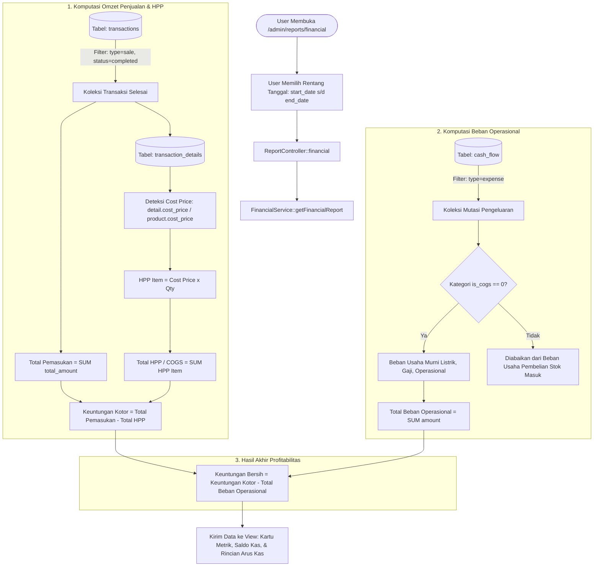

# Dokumentasi Teknis: Logika & Perhitungan Keuntungan Bersih (Laporan Keuangan)

Dokumen ini menjelaskan secara menyeluruh alur kerja (*workflow*), rumus matematis, struktur basis data, serta mekanisme pencegahan kesalahan hitung ganda (*double-counting*) dalam menghitung **Keuntungan Bersih (Net Profit)** pada sistem **BUKU-DIGITAL**.

---

## 1. Peta File & Arsitektur Kode

Halaman Laporan Keuangan dapat diakses melalui rute `/admin/reports/financial` (`reports.financial`).

| Layer | File Sumber | Peran & Tanggung Jawab |
| :--- | :--- | :--- |
| **Routing** | `routes/admin.php` | Mendaftarkan route GET laporan keuangan dan export PDF |
| **Controller** | `app/Http/Controllers/Admin/ReportController.php` | Menerima parameter request tanggal, memanggil service keuangan, dan merender view |
| **Core Service** | `app/Services/Admin/FinancialService.php` | Menjalankan logika komputasi omzet, HPP per transaksi, beban operasional, saldo rekening, dan laba bersih |
| **Blade View** | `resources/views/admin/reports/financial.blade.php` | Menyajikan ringkasan kartu metrik laba, saldo kas realtime, tabel paginasi arus kas, dan formula ringkasan |
| **Export Template**| `resources/views/admin/reports/financial_pdf.blade.php` | Menghasilkan berkas PDF cetak laporan keuangan (berisi seluruh arus kas tanpa pembatasan paginasi) |
| **Models** | `Transaction.php`, `TransactionDetail.php`, `CashFlow.php`, `ExpenseCategory.php` | Entitas Eloquent untuk membaca data transaksi, perincian harga pokok produk, dan mutasi kas |

---

## 2. Diagram Alur Kerja (Workflow Diagram)



---

## 3. Rumus dan Logika Matematis Terperinci

Sistem menerapkan model **Multi-Step Income Statement** yang memisahkan beban langsung barang dagangan dari beban rutin operasional.

### A. Total Pemasukan (`total_income`)
Omzet pendapatan kotor dari transaksi penjualan yang berstatus selesai (`completed`).

* **Kriteria Query Database**:
  * `type = 'sale'`
  * `business_id = Auth::user()->business_id`
  * `status = 'completed'`
  * `transaction_date BETWEEN start_date AND end_date`
* **Formula**:
  $$\text{Total Pemasukan} = \sum_{i=1}^{n} \text{Transaction}[i].\text{total\_amount}$$

---

### B. Total Harga Pokok Penjualan (HPP / COGS - `total_cogs`)
Total modal yang dikeluarkan untuk memproduksi atau membeli barang yang **benar-benar telah laku terjual** dalam rentang waktu yang dipilih.

* **Logika Fallback Modal (4-Tier Fallback)**:
  Sistem menjamin keakuratan modal dengan membaca snapshot harga modal pada saat transaksi terjadi:
  ```php
  $costPrice = $detail->cost_price 
            ?? $detail->unit_cost 
            ?? $detail->purchase_price 
            ?? optional($detail->product)->cost_price 
            ?? 0;
  ```
* **Formula**:
  $$\text{HPP Transaksi} = \sum (\text{costPrice} \times \text{quantity})$$
  $$\text{Total HPP (COGS)} = \sum_{j=1}^{n} \text{HPP Transaksi}[j]$$

> **Catatan Akuntansi**: HPP dihitung langsung dari barang yang keluar (*matching principle*), bukan dari akumulasi dana yang keluar saat membeli stok ke gudang.

---

### C. Keuntungan Kotor / Laba Kotor (`total_gross_profit`)
Margin keuntungan kotor murni antara harga jual barang ke pembeli dengan harga modal pokok barang tersebut.

* **Formula**:
  $$\text{Keuntungan Kotor} = \text{Total Pemasukan} - \text{Total HPP (COGS)}$$

---

### D. Beban Operasional (`total_expense`)
Biaya-biaya operasional di luar modal barang yang dikeluarkan untuk menjaga kelangsungan bisnis (seperti listrik, air, gaji pegawai, perawatan mesin, konsumsi, dan operasional kantor).

* **Kriteria Query Database**:
  * `type = 'expense'`
  * `business_id = Auth::user()->business_id`
  * `category.is_cogs = 0` (hanya kategori operasional non-HPP)
  * `date BETWEEN start_date AND end_date`
* **Formula**:
  $$\text{Total Beban Operasional} = \sum_{\text{is\_cogs}=0} \text{CashFlow}.\text{amount}$$

---

### E. Keuntungan Bersih (`net_profit`)
Laba bersih riil perusahaan setelah memperhitungkan seluruh modal pokok barang dan biaya operasional usaha.

* **Formula Final**:
  $$\mathbf{\text{Keuntungan Bersih}} = \mathbf{\text{Keuntungan Kotor}} - \mathbf{\text{Total Beban Operasional}}$$
  atau dijabarkan:
  $$\mathbf{\text{Keuntungan Bersih}} = (\mathbf{\text{Total Pemasukan}} - \mathbf{\text{Total HPP}}) - \mathbf{\text{Total Beban Operasional}}$$

---

## 4. Mekanisme Pencegahan "Double-Counting" Modal

Dalam sistem ini, terdapat pemisahan tegas antara pengeluaran **Pembelian Stok (Restock)** dan **Beban Operasional Usaha**:

1. **Pencatatan Restock ke Kasir/Gudang**:
   Ketika admin/kasir menambah stok melalui faktur supplier, transaksi kas keluar dicatat ke `cash_flow` dengan kategori bertanda:
   ```php
   'is_cogs' => 1
   ```
2. **Pengecualian saat Menghitung Beban Operasional**:
   Jika pengeluaran restock tersebut dimasukkan lagi ke dalam `total_expense`, maka modal barang akan **terpotong dua kali**:
   * *Pemotongan ke-1*: Saat kas keluar untuk beli stok dari supplier.
   * *Pemotongan ke-2*: Saat barang terjual melalui kalkulasi HPP (`detail->cost_price * quantity`).
3. **Hasil Solusi**:
   `FinancialService` hanya menjumlahkan kategori dengan `is_cogs = 0`. Pembelian stok hanya mempengaruhi **Arus Kas Riil (Cash Flow/Saldo Laci)** dan tidak mengurangi Laba Bersih sampai barang tersebut benar-benar terjual.

---

## 5. Simulasi Perhitungan Kasus Nyata

Sebagai contoh kasus pada periode 1 bulan kalender:

1. **Aktivitas Penjualan**:
   * Terjual 100 Ball Es Kristal @ Rp 20.000 = **Rp 2.000.000**
2. **Modal Pokok (HPP Produk)**:
   * Harga modal per Ball = Rp 8.000
   * Total HPP = $100 \times \text{Rp } 8.000$ = **Rp 800.000**
3. **Pembelian Stok Baru dari Supplier**:
   * Beli 300 Ball dari supplier seharga Rp 2.400.000 (`is_cogs = 1`, masuk gudang)
4. **Biaya Operasional Rutin**:
   * Tagihan Listrik PLN: Rp 350.000 (`is_cogs = 0`)
   * Gaji Karyawan: Rp 450.000 (`is_cogs = 0`)
   * Total Operasional = **Rp 800.000**

### Ringkasan Tampilan Laporan Keuangan:

| Label di Layar | Angka | Logika & Rumus |
| :--- | :--- | :--- |
| **Total Pemasukan** | **Rp 2.000.000** | Omzet dari 100 Ball terjual |
| **Total HPP (COGS)** | **Rp 800.000** | $100 \times \text{Rp } 8.000$ (HPP barang terjual) |
| **Keuntungan Kotor** | **Rp 1.200.000** | $\text{Rp } 2.000.000 - \text{Rp } 800.000$ |
| **Pengeluaran Operasional** | **Rp 800.000** | Listrik + Gaji. *(Pembelian stok 2.4jt diabaikan di sini)* |
| **Keuntungan Bersih** | **Rp 400.000** | $\mathbf{\text{Rp } 1.200.000 - \text{Rp } 800.000}$ |

---

## 6. Laba Bersih vs Saldo Kas Realtime

Halaman laporan keuangan menampilkan dua sudut pandang berbeda:

* **Keuntungan Bersih (Profitability)**: Berbasis pencocokan pendapatan dan beban (*Matching Principle / Akrual*). Mengukur apakah usaha mencetak profit dari barang yang terjual.
* **Saldo Kas & Rekening (Liquidity)**: Berbasis uang tunai fisik yang ada di laci kasir atau rekening bank:
  $$\text{Saldo Kas} = \sum (\text{CashFlow Income}) - \sum (\text{CashFlow Expense})$$

---

## 7. Integrasi Lanjutan: Tutup Buku & Alokasi Dana Profit

Setelah nilai Keuntungan Bersih terbentuk:
1. **Tutup Buku Bulanan (`FinancialController::processMonthlyClosing`)**:
   Sistem mengunci nilai Keuntungan Bersih bulan terkait ke tabel `owner_profits` dengan status `pending`.
2. **Alokasi Dana Profit (`FundAllocationService::processAllocation`)**:
   Keuntungan bersih tersebut dapat dialokasikan secara proporsional sesuai konfigurasi bisnis, misalnya:
   * **30%** Gaji Pemilik
   * **40%** Reinvestasi Modal Usaha
   * **20%** Dana Darurat
   * **10%** Dividen / Pembagian Hasil
