# ANALISIS LOGIKA HARGA POKOK PENJUALAN (HPP / COST_PRICE)
**Sistem Aplikasi BUKU-DIGITAL (Laravel Backend & Accounting Review)**  
*Dokumen Analisis Read-Only & Audit Forensik Logika Akuntansi*

---

## DAFTAR ISI
1. [Peta Arsitektur File & Kode Terkait HPP](#1-peta-arsitektur-file--kode-terkait-hpp)
2. [Diagram Alur Data HPP (Mermaid Workflow)](#2-diagram-alur-data-hpp-mermaid-workflow)
3. [Analisis Rumus Rata-Rata (Moving Average Cost)](#3-analisis-rumus-rata-rata-moving-average-cost)
4. [Daftar Kelemahan & Bug Sistem (Berdasarkan Tingkat Keparahan)](#4-daftar-kelemahan--bug-sistem-berdasarkan-tingkat-keparahan)
5. [Daftar Hipotesis Penyebab Angka Identik (17571.04, dll)](#5-daftar-hipotesis-penyebab-angka-identik-1757104-dll)
6. [SQL Read-Only (Khusus phpMyAdmin) untuk Pembuktian Mandiri](#6-sql-read-only-khusus-phpmyadmin-untuk-pembuktian-mandiri)
7. [Rekomendasi Solusi & Desain Perbaikan (Tidak Diterapkan)](#7-rekomendasi-solusi--desain-perbaikan-tidak-diterapkan)

---

## 1. PETA ARSITEKTUR FILE & KODE TERKAIT HPP

Berikut adalah seluruh titik dalam sistem tempat variabel HPP (`cost_price`) dibaca, dihitung, ditulis, atau disajikan:

### A. Titik Penulisan / Perubahan `products.cost_price`
| No | File Sumber | Method / Fungsi | Baris | Keterangan |
|---|---|---|---|---|
| 1 | `app/Http/Controllers/Kasir/InventoryController.php` | `storeStock()` | [L88-100](file:///c:/Users/Administrator/Documents/BUKU-DIGITAL/app/Http/Controllers/Kasir/InventoryController.php#L88-L100) | Menghitung Moving Average saat terima stok supplier, update `products.cost_price` |
| 2 | `app/Http/Controllers/Kasir/InventoryController.php` | `processBreakUnit()` | [L310-321](file:///c:/Users/Administrator/Documents/BUKU-DIGITAL/app/Http/Controllers/Kasir/InventoryController.php#L310-L321) | Menghitung HPP proporsional saat pecah ball, update `products.cost_price` anak |
| 3 | `app/Services/Admin/InventoryService.php` | `breakUnit()` | [L153-163](file:///c:/Users/Administrator/Documents/BUKU-DIGITAL/app/Services/Admin/InventoryService.php#L153-L163) | Pecah ball versi Admin Service, update `cost_price` produk pecahan |
| 4 | `app/Services/Admin/ProductService.php` | `createProduct()`, `updateProduct()` | [L41, L81](file:///c:/Users/Administrator/Documents/BUKU-DIGITAL/app/Services/Admin/ProductService.php#L41) | Form input/edit master produk oleh Admin |
| 5 | `app/Http/Requests/Admin/StoreProductRequest.php` & `UpdateProductRequest.php` | `rules()` | [L31](file:///c:/Users/Administrator/Documents/BUKU-DIGITAL/app/Http/Requests/Admin/StoreProductRequest.php#L31) | Validasi form: `'cost_price' => ['required', 'numeric', 'min:0', 'lte:base_price']` |

### B. Titik Penulisan / Snapshot `transaction_details.cost_price`
| No | File Sumber | Method / Fungsi | Baris | Keterangan |
|---|---|---|---|---|
| 1 | `app/Services/Kasir/PosService.php` | `createTransaction()` | [L356-362](file:///c:/Users/Administrator/Documents/BUKU-DIGITAL/app/Services/Kasir/PosService.php#L356-L362) | Penjualan langsung POS Kasir: snapshot `$product->cost_price ?? 0` |
| 2 | `app/Services/Kasir/PosService.php` | `createBatchDeliveryTransactions()` | [L226-232](file:///c:/Users/Administrator/Documents/BUKU-DIGITAL/app/Services/Kasir/PosService.php#L226-L232) | Penjualan rombongan pengiriman driver: snapshot `$product->cost_price ?? 0` |
| 3 | `app/Services/Kasir/TransactionService.php` | `update()` | [L95-96](file:///c:/Users/Administrator/Documents/BUKU-DIGITAL/app/Services/Kasir/TransactionService.php#L95-L96) | Edit transaksi: `$item['cost_price'] ?? $product->cost_price ?? 0` |
| 4 | `app/Http/Controllers/Api/V1/Kasir/PosApiController.php` | `store()` | [L111](file:///c:/Users/Administrator/Documents/BUKU-DIGITAL/app/Http/Controllers/Api/V1/Kasir/PosApiController.php#L111) | Transaksi via REST API Kasir: snapshot `$product->cost_price ?? 0` |
| 5 | `database/migrations/2026_10_17_170000_add_cost_price_to_transaction_details_table.php` | `up()` | [L14-18](file:///c:/Users/Administrator/Documents/BUKU-DIGITAL/database/migrations/2026_10_17_170000_add_cost_price_to_transaction_details_table.php#L14-L18) | Migrasi penambahan kolom `cost_price` (`nullable()`) pada 17 Oktober 2026 |

### C. Titik Pembacaan HPP untuk Laporan Keuangan
| No | File Sumber | Method / Fungsi | Baris | Perlakuan Khusus |
|---|---|---|---|---|
| 1 | `app/Services/Admin/FinancialService.php` | `getFinancialReport()` | [L90-108](file:///c:/Users/Administrator/Documents/BUKU-DIGITAL/app/Services/Admin/FinancialService.php#L90-L108) | Membaca fallback HPP detail -> master product. **Tidak memfilter ongkir**. |
| 2 | `app/Services/Admin/FinancialService.php` | `getFinancialReportForExport()` | [L164-180](file:///c:/Users/Administrator/Documents/BUKU-DIGITAL/app/Services/Admin/FinancialService.php#L164-L180) | Versi ekspor PDF. **Tidak memfilter ongkir**. |
| 3 | `app/Services/Admin/FinancialService.php` | `processMonthlyClosing()` | [L355-365](file:///c:/Users/Administrator/Documents/BUKU-DIGITAL/app/Services/Admin/FinancialService.php#L355-L365) | Eksekusi tutup buku bulanan. **Tidak memfilter ongkir**. |
| 4 | `app/Services/Admin/DashboardService.php` | `getSalesBreakdownAndCOGS()` | [L461-479](file:///c:/Users/Administrator/Documents/BUKU-DIGITAL/app/Services/Admin/DashboardService.php#L461-L479) | HPP Dashboard. **Memfilter / mengabaikan ongkir** (`isOngkir -> continue`). |

---

## 2. DIAGRAM ALUR DATA HPP (MERMAID WORKFLOW)

```mermaid
flowchart TD
    subgraph S1 [1. Alur Pembelian / Restock]
        A[Supplier Kirim Es] --> B[Kasir Buka Form /kasir/inventory/add-stock]
        B --> C[Input: quantity & purchase_price per unit]
        C --> D{Stok Sebelum Masuk <= 0?}
        D -->|Ya: Stok 0 atau Minus| E[HPP Baru = purchase_price]
        D -->|Tidak: Stok Positif| F[Hitung Moving Average: Stok x HPP Lama + Qty x Beli / Total Stok]
        E & F --> G[UPDATE products.cost_price = newCogs]
        G --> H[UPDATE inventory.current_stock += quantity]
    end

    subgraph S2 [2. Alur Pecah Ball / Konversi]
        I[Kasir / Admin Pecah Ball Induk 20KG] --> J[Hitung Modal Induk Terpakai = Qty Induk x cost_price Induk]
        J --> K[Alokasi ke Pecahan 10KG, 15KG, 5KG via Bobot Nama Produk]
        K --> L[Hitung Moving Average Pecahan Anak]
        L --> M[UPDATE products.cost_price Produk Anak]
    end

    subgraph S3 [3. Alur Penjualan POS]
        N[Kasir Input Penjualan di POS] --> O[Barang Terjual: Qty]
        O --> P[Ambil Snapshot: detail.cost_price = product.cost_price]
        P --> Q[INSERT INTO transaction_details: cost_price tersimpan permanen]
        Q --> R[inventory.current_stock -= Qty]
    end

    subgraph S4 [4. Alur Pelaporan Keuangan]
        S[Admin Buka Laporan Keuangan] --> T[Ambil Transactions completed]
        T --> U{Apakah detail.cost_price bernilai NULL?}
        U -->|Ya: Data Sebelum 17 Okt| V[Fallback: Ambil products.cost_price TERKINI]
        U -->|Tidak: Data Setelah 17 Okt| W[Gunakan detail.cost_price Snapshot]
        V & W --> X[HPP Transaksi = costPrice x Qty]
        X --> Y[Total HPP = SUM HPP Transaksi TERMASUK ONGKIR]
        Y --> Z[Laba Kotor = Omzet - Total HPP]
    end
```



---

## 3. ANALISIS RUMUS RATA-RATA (MOVING AVERAGE COST)

Rumus yang tertanam pada `Kasir\InventoryController::storeStock` (baris 91–97) adalah metode **Moving Weighted Average** per kejadian transaksi masuk:

$$\text{HPP Baru} = \begin{cases} P_{\text{in}}, & \text{jika } S_{\text{awal}} \le 0 \\ \dfrac{(S_{\text{awal}} \times C_{\text{awal}}) + (Q_{\text{in}} \times P_{\text{in}})}{S_{\text{awal}} + Q_{\text{in}}}, & \text{jika } S_{\text{awal}} > 0 \end{cases}$$

### Keterangan Variabel:
* $S_{\text{awal}}$ (`$currentStock`): Saldo stok fisik pada tabel `inventory.current_stock` sesaat sebelum transaksi dicatat.
* $C_{\text{awal}}$ (`$currentCogs`): Nilai `products.cost_price` sesaat sebelum transaksi dicatat.
* $Q_{\text{in}}$ (`$addedQty`): Jumlah fisik barang yang masuk dari faktur penerimaan.
* $P_{\text{in}}$ (`$purchasePricePerUnit`): Harga beli per unit yang diisi oleh kasir (atau fallback dari tabel pivot supplier).

### Evaluasi Kritis Akuntansi Terhadap Rumus Ini:
1. **Denominator**:
   Denominator adalah $(S_{\text{awal}} + Q_{\text{in}})$. Ini mengasumsikan seluruh stok $S_{\text{awal}}$ masih utuh secara fisik dengan nilai per unit $C_{\text{awal}}$.
2. **Perilaku Bila Stok Negatif ($S_{\text{awal}} \le 0$)**:
   Jika kasir terlambat mencatat restock dan penjualan terus berjalan, $S_{\text{awal}}$ menjadi negatif (misal $-20$). 
   * Sistem memilih cabang: `$newCogs = $purchasePricePerUnit`.
   * **Dampak**: Seluruh histori modal barang lama langsung terhapus. Harga beli terakhir mengambil alih 100% nilai HPP master produk.
3. **Penyusutan Fisik / Es Meleleh (Shrinkage)**:
   Bisnis es kristal memiliki karakteristik fisik meleleh (*melting loss*). Jika sistem mencatat stok di sistem $S_{\text{awal}} = 50$, padahal es yang tersisa di freezer hanya $10$ karena mencair, maka pembobot $(50 \times C_{\text{awal}})$ akan menahan modal semu yang sudah tidak ada barang fisiknya. Ini memicu distorsi harga rata-rata secara kumulatif.

---

## 4. DAFTAR KELEMAHAN & BUG SISTEM (BERDASARKAN TINGKAT KEPARAHAN)

### 🔴 Kelemahan 1: Migrasi Kolom 17 Oktober 2026 Tanpa Data Backfill (Paling Menjelaskan Data Identik)
* **Lokasi Kode**: [`database/migrations/2026_10_17_170000_add_cost_price_to_transaction_details_table.php:16`](file:///c:/Users/Administrator/Documents/BUKU-DIGITAL/database/migrations/2026_10_17_170000_add_cost_price_to_transaction_details_table.php#L16)
* **Kutipan Kode**:
  ```php
  $table->decimal('cost_price', 15, 2)->nullable()->after('quantity');
  ```
* **Dampak Akuntansi**:
  Sebelum tanggal 17 Oktober 2026, kolom `cost_price` belum ada di tabel `transaction_details`. Saat migrasi dijalankan, seluruh baris historis (1–16 Oktober) bernilai **`NULL`**.
  Ketika Laporan Keuangan dijalankan, fungsi fallback di [FinancialService.php:94](file:///c:/Users/Administrator/Documents/BUKU-DIGITAL/app/Services/Admin/FinancialService.php#L94) mengevaluasi:
  ```php
  $costPrice = $detail->cost_price ?? $detail->unit_cost ?? $detail->purchase_price ?? optional($detail->product)->cost_price ?? 0;
  ```
  Karena `detail->cost_price` adalah `NULL`, sistem **secara dinamis mengambil `product->cost_price` saat ini (17571.04)** untuk seluruh transaksi lama! Ratusan baris penjualan yang terjadi berminggu-minggu lalu seketika terhitung menggunakan HPP tunggal hari ini.

---

### 🔴 Kelemahan 2: Bug Operator Null Coalescing (`??`) terhadap Nilai `0`
* **Lokasi Kode**: [`app/Services/Admin/FinancialService.php:94`](file:///c:/Users/Administrator/Documents/BUKU-DIGITAL/app/Services/Admin/FinancialService.php#L94)
* **Kutipan Kode**:
  ```php
  $costPrice = $detail->cost_price ?? $detail->unit_cost ?? $detail->purchase_price ?? optional($detail->product)->cost_price ?? 0;
  ```
* **Dampak Teknis & Akuntansi**:
  Di PHP, operator `??` hanya memeriksa apakah operand sebelah kiri bernilai `NULL`. Jika sebuah transaksi tersimpan dengan `cost_price = 0` (misalnya karena saat transaksi dibuat master produk belum diisi modalnya), maka:
  ```php
  0.00 ?? optional($detail->product)->cost_price
  ```
  **Hasilnya tetap `0.00`**! Nilai `0` **TIDAK PERNAH** jatuh ke fallback `product->cost_price`. Transaksi tersebut selamanya memiliki HPP Rp 0, yang membuat laba kotor tampak 100% fiktif.

---

### 🔴 Kelemahan 3: Produk Jasa "ONGKOS KIRIM" Dihitung HPP-nya di Laporan Keuangan (Rp 546,24)
* **Lokasi Kode**: 
  - Tidak ada filter di [`FinancialService.php:90-108`](file:///c:/Users/Administrator/Documents/BUKU-DIGITAL/app/Services/Admin/FinancialService.php#L90-L108)
  - Sedangkan di [`DashboardService.php:469-472`](file:///c:/Users/Administrator/Documents/BUKU-DIGITAL/app/Services/Admin/DashboardService.php#L469-L472) filter itu ADA:
  ```php
  // Abaikan ongkos kirim dari hitungan COGS
  $isOngkir = str_contains(strtolower($pName), 'ongkos kirim') || str_contains(strtolower($pName), 'ongkir');
  if ($isOngkir) {
      continue;
  }
  ```
* **Dampak Akuntansi**:
  Ongkos kirim adalah produk pendapatan jasa transportasi, bukan barang inventaris dagang. Membiarkan ONGKOS KIRIM memiliki HPP sebesar Rp 546,24 dan menjumlahkannya ke HPP Penjualan di Laporan Keuangan adalah **kesalahan ganda**:
  1. HPP perusahaan menggelembung oleh transaksi non-barang.
  2. Terjadi inkonsistensi data: HPP di Dashboard berbeda dengan HPP di Laporan Keuangan Web dan Ekspor PDF!

---

### 🟡 Kelemahan 4: Potensi Human Error Input "Total Faktur" Menjadi "Harga Satuan"
* **Lokasi Kode**: [`resources/views/kasir/inventory/add_stock.blade.php:83-91`](file:///c:/Users/Administrator/Documents/BUKU-DIGITAL/resources/views/kasir/inventory/add_stock.blade.php#L83-L91)
* **Dampak Akuntansi**:
  Form `add_stock` hanya memiliki input teks terbuka untuk `purchase_price` tanpa batas atas (upper bound validation). Jika kasir membeli 100 Ball es seharga total faktur Rp 1.200.000, lalu salah memasukkan Rp 1.200.000 (bukan Rp 12.000), sistem langsung menghitung rata-rata dan melejitkan `products.cost_price` ke angka puluhan/ratusan ribu rupiah.

---

### 🟡 Kelemahan 5: Kerentanan Race Condition & Ketidaksinkronan Stok Admin vs Kasir
* **Lokasi Kode**: 
  - Kasir Terima Stok: [`Kasir/InventoryController.php:60-103`](file:///c:/Users/Administrator/Documents/BUKU-DIGITAL/app/Http/Controllers/Kasir/InventoryController.php#L60-L103) (Mengupdate HPP)
  - Admin Tambah Stok: [`Admin/InventoryService.php:51-66`](file:///c:/Users/Administrator/Documents/BUKU-DIGITAL/app/Services/Admin/InventoryService.php#L51-L66) (**TIDAK MENGUPDATE HPP**)
* **Dampak Akuntansi**:
  Jika Admin menambahkan stok via menu Admin Inventory, stok fisik bertambah tetapi HPP tidak dihitung ulang. Ketika kasir kemudian memasukkan restock via kasir, penyebut (*denominator*) stok telah membengkak tanpa nilai modal pendamping, mengacaukan bobot rata-rata tertimbang. Selain itu, kedua fungsi tidak menggunakan `lockForUpdate()`, sehingga rentan terhadap benturan kalkulasi saat pesanan POS serentak.

---

## 5. DAFTAR HIPOTESIS PENYEBAB ANGKA IDENTIK (17571.04, DLL)

Berikut hipotesis terurut dari tingkat keyakinan tertinggi berdasarkan bukti arsitektur kode:

| No | Hipotesis | Tingkat Keyakinan | Deskripsi Mekanisme |
|---|---|---|---|
| **H-1** | **Efek Fallback `NULL` Pasca Migrasi 17 Oktober 2026** | **TINGGI (High)** | Seluruh 555 baris transaksi 20 KG tersebut sebenarnya memiliki `transaction_details.cost_price = NULL` (karena dibuat sebelum 17 Okt). Saat dilihat di laporan, query dinamis mengeksekusi `optional($product)->cost_price`, yang saat itu bernilai 17571.04. |
| **H-2** | **Statis Snapshot Setelah Restock Tunggal Bernilai 17571.04** | **SEDANG (Medium)** | Pada suatu hari di pertengahan Oktober, terjadi transaksi restock supplier atau pecah ball yang memutakhirkan `products.cost_price` produk 11 menjadi 17571.04. Selama beberapa waktu setelahnya, belum ada restock baru, sehingga 555 transaksi POS yang dibuat berturut-turut mengambil snapshot persis angka tersebut. |
| **H-3** | **Eksekusi Script SQL Backfill Manual Satu Kali** | **SEDANG (Medium)** | Setelah migrasi kolom dijalankan, seorang developer/admin menjalankan query manual: `UPDATE transaction_details SET cost_price = (SELECT cost_price FROM products WHERE id=product_id) WHERE cost_price IS NULL`. Ini menyamaratakan seluruh transaksi lampau dengan angka master hari itu. |
| **H-4** | **Asal Usul Angka Pecahan (Rasio Pecah Ball)** | **TINGGI (High)** | Angka Produk 10 KG (**7028.42**) adalah **PERSIS 40.00%** dari Produk 20 KG (**17571.04**): $17571.04 \times 0.40 = 7028.416 \rightarrow \mathbf{7028.42}$. Ini adalah bukti matematis tak terbantahkan bahwa produk 10 KG di-update oleh fungsi **Pecah Ball** ([Kasir/InventoryController.php:320](file:///c:/Users/Administrator/Documents/BUKU-DIGITAL/app/Http/Controllers/Kasir/InventoryController.php#L320)) yang merujuk pada modal induk 20 KG (bobot 10kg/20kg = 50% atau rasio harga jual 40%). |
| **H-5** | **Asal Usul HPP ONGKOS KIRIM (546.24)** | **SEDANG (Medium)** | Terjadi saat proses Pecah Ball yang melibatkan produk non-bobot (`$allHaveWeight = false`) sehingga biaya terbagi proporsional ke seluruh produk berdasar harga jual, atau Admin menginput manual angka tersebut di form master produk karena kolom `cost_price` diwajibkan (`required`). |

---

## 6. SQL READ-ONLY (KHUSUS PHPMYADMIN) UNTUK PEMBUKTIAN MANDIRI

Silakan jalankan query **SELECT murni** berikut di phpMyAdmin untuk membuktikan hipotesis di atas tanpa risiko mengubah data:

### Query 1: Membuktikan Apakah Nilai 17571.04 Tersimpan Fisik atau Berasal dari `NULL`
```sql
SELECT 
    td.id AS detail_id,
    td.transaction_id,
    t.transaction_date,
    td.product_id,
    p.name AS product_name,
    td.quantity,
    td.cost_price AS snapshot_detail,
    p.cost_price AS current_master_price,
    CASE 
        WHEN td.cost_price IS NULL THEN 'DARI FALLBACK MASTER (NULL)'
        WHEN td.cost_price = 17571.04 THEN 'SNAPSHOT TERSIMPAN FISIK'
        ELSE 'NILAI LAIN'
    END AS status_data
FROM transaction_details td
JOIN transactions t ON td.transaction_id = t.id
JOIN products p ON td.product_id = p.id
WHERE td.product_id = 11
ORDER BY t.transaction_date ASC;
```

---

### Query 2: Mengetahui Tanggal & Nomor Nota Pertama vs Terakhir dari Nilai 17571.04
```sql
SELECT 
    MIN(t.transaction_date) AS nota_pertama_tanggal,
    MIN(t.id) AS nota_pertama_id,
    MAX(t.transaction_date) AS nota_terakhir_tanggal,
    MAX(t.id) AS nota_terakhir_id,
    COUNT(td.id) AS total_baris_terdampak,
    SUM(td.quantity) AS total_qty_terdampak,
    AVG(td.unit_price) AS rata_rata_harga_jual
FROM transaction_details td
JOIN transactions t ON td.transaction_id = t.id
WHERE td.product_id = 11 
  AND (td.cost_price = 17571.04 OR (td.cost_price IS NULL AND (SELECT cost_price FROM products WHERE id=11) = 17571.04));
```

---

### Query 3: Audit Riwayat Penerimaan Stok & Catatan HPP Produk 11 (Agustus – Oktober 2026)
```sql
SELECT 
    sm.id,
    sm.created_at,
    sm.type,
    sm.quantity,
    sm.reference_id,
    sm.notes,
    u.name AS operator
FROM stock_movements sm
LEFT JOIN users u ON sm.created_by = u.id
WHERE sm.product_id = 11 
  AND sm.created_at >= '2026-08-01 00:00:00'
ORDER BY sm.created_at DESC;
```

---

### Query 4: Profil HPP Master Produk Saat Ini & Status Null Detail Transaksi
```sql
SELECT 
    p.id,
    p.name,
    p.cost_price AS master_cost_price,
    p.base_price AS selling_price,
    COUNT(td.id) AS total_transaksi,
    SUM(CASE WHEN td.cost_price IS NULL THEN 1 ELSE 0 END) AS qty_detail_null,
    SUM(CASE WHEN td.cost_price = 0 THEN 1 ELSE 0 END) AS qty_detail_nol,
    SUM(CASE WHEN td.cost_price > 0 THEN 1 ELSE 0 END) AS qty_detail_terisi
FROM products p
LEFT JOIN transaction_details td ON p.id = td.product_id
WHERE p.id IN (11, 12, 14, 15, 16, 23)
GROUP BY p.id, p.name, p.cost_price, p.base_price;
```

---

### Query 5: Deteksi Apakah Stok Pernah Negatif Sebelum Restock Masuk
```sql
SELECT 
    sm.product_id,
    p.name,
    sm.created_at,
    sm.type,
    sm.quantity,
    sm.notes
FROM stock_movements sm
JOIN products p ON sm.product_id = p.id
WHERE sm.product_id IN (11, 12, 14, 16)
  AND sm.type = 'out'
ORDER BY sm.created_at ASC;
```

---

### Query 6: Rekonsiliasi Total Belanja Kasir vs Total HPP Transaksi (Oktober 2026)
```sql
SELECT 
    '1. Belanja Riil Kas (Refill Es + Bahan)' AS kategori,
    COALESCE(SUM(cf.amount), 0) AS total_rupiah
FROM cash_flow cf
WHERE cf.type = 'expense'
  AND cf.date BETWEEN '2026-10-01' AND '2026-10-31'
  AND cf.category_id IN (SELECT id FROM expense_categories WHERE is_cogs = 1)

UNION ALL

SELECT 
    '2. Total HPP Penjualan di Sistem' AS kategori,
    COALESCE(SUM(
        td.quantity * COALESCE(td.cost_price, p.cost_price, 0)
    ), 0) AS total_rupiah
FROM transaction_details td
JOIN transactions t ON td.transaction_id = t.id
JOIN products p ON td.product_id = p.id
WHERE t.type = 'sale'
  AND t.status = 'completed'
  AND t.transaction_date BETWEEN '2026-10-01 00:00:00' AND '2026-10-31 23:59:59';
```

---

## 7. REKOMENDASI SOLUSI & DESAIN PERBAIKAN (TIDAK DITERAPKAN)

*Catatan: Sesuai instruksi tugas, rekomendasi ini bersifat proposal arsitektur dan **TIDAK DITERAPKAN** ke dalam kode saat ini.*

### Rekomendasi 1: Filter Produk Non-Stok / Jasa di Seluruh Service Laporan Keuangan
Di [`FinancialService.php`](file:///c:/Users/Administrator/Documents/BUKU-DIGITAL/app/Services/Admin/FinancialService.php#L90-L108), tambahkan pengecualian produk ongkos kirim seperti yang sudah diterapkan di `DashboardService`:
```php
// Proposal perbaikan di FinancialService loop details:
$pName = optional($detail->product)->name ?? '';
if (str_contains(strtolower($pName), 'ongkos kirim') || str_contains(strtolower($pName), 'ongkir') || optional($detail->product)->unit === 'Jalan') {
    continue; // Jangan hitung HPP untuk ongkir
}
```

### Rekomendasi 2: Validasi Batas Wajar Harga Beli di Form Kasir
Tambahkan validasi batas atas pada `Kasir\InventoryController` agar kasir tidak dapat memasukkan total faktur ke dalam kolom harga satuan:
```php
'purchase_price' => 'required|numeric|min:1000|max:50000', // Batasi rentang wajar harga es kristal
```

### Rekomendasi 3: Perbaikan Operator Fallback HPP
Ubah fallback di `FinancialService` agar mengenali nilai `0` sebagai data kosong:
```php
// Ubah dari:
$costPrice = $detail->cost_price ?? ... ?? optional($detail->product)->cost_price ?? 0;

// Menjadi:
$costPrice = (!empty($detail->cost_price) && $detail->cost_price > 0)
    ? (float) $detail->cost_price
    : (float) (optional($detail->product)->cost_price ?? 0);
```

### Rekomendasi 4: Skrip Koreksi Historis (Safe Dry-Run Script Pattern)
Jika di kemudian hari ingin dilakukan koreksi historis pada transaksi Oktober 2026, buat command artisan khusus yang aman dengan prosedur:
1. Wajib memiliki flag `--dry-run` untuk melihat data sebelum diubah.
2. Wajib membatasi `WHERE business_id = ?` dan rentang tanggal nota.
3. Mengembalikan HPP 20 KG ke harga beli historis supplier yang sebenarnya (misal Rp 12.000) dan HPP Ongkir ke Rp 0.

---

## 8. FORENSIK MENDALAM: BEDAH 6 PERTANYAAN KRUSIAL

Bagian ini menjawab secara spesifik kontradiksi data di mana ditemukan transaksi riil ber-HPP Rp 11.500 – Rp 13.000 berdampingan dengan 555+50+22 baris identik Rp 17.571,04.

### 1. Skema Tabel Riwayat Stok yang Sebenarnya (`stock_movements`)
Berdasarkan berkas migrasi [`2024_01_01_000012_create_stock_movements_table.php`](file:///c:/Users/Administrator/Documents/BUKU-DIGITAL/database/migrations/2024_01_01_000012_create_stock_movements_table.php#L14-L23), [`2025_07_13_181929_add_business_id_to_stock_movements_table.php`](file:///c:/Users/Administrator/Documents/BUKU-DIGITAL/database/migrations/2025_07_13_181929_add_business_id_to_stock_movements_table.php), dan dump database (`struktur_db.txt:675-686`), tabel riwayat mutasi stok yang sebenarnya adalah:

* **Nama Tabel**: `stock_movements`
* **Kolom Resmi**:
  1. `id` (`bigint unsigned`, Primary Key, Auto Increment)
  2. `business_id` (`bigint unsigned`, Foreign Key)
  3. `product_id` (`bigint unsigned`, Foreign Key ke `products.id`)
  4. `type` (`enum('in','out','adjustment','waste')`)
  5. `quantity` (`int(11)`)
  6. `reference_id` (`varchar(191)`, Nullable, contoh: `'supplier:2'`, `'TX-105'`)
  7. `notes` (`text`, Nullable, mencatat deskripsi transaksi)
  8. `created_by` (`bigint unsigned`, Nullable, Foreign Key ke `users.id`)
  9. `created_at` (`timestamp`, Nullable)
  10. `updated_at` (`timestamp`, Nullable)

*(Catatan: Tabel ini **tidak memiliki** kolom `price` atau `cost_price`. Riwayat harga beli saat restock disimpan sebagai teks di dalam kolom `notes`)*.

---

### 2. Dari Mana Angka 17.571,04 Pertama Kali Dihasilkan?
#### A. Penelusuran Jalur Penulisan `products.cost_price` Produk 11 (20 KG):
1. **`processBreakUnit` / `breakUnit` (Pecah Ball)**:
   - **TIDAK PERNAH MENULIS BALIK KE PRODUK INDUK (20 KG)**.
   - Bukti kode: Di [Kasir/InventoryController.php:319-321](file:///c:/Users/Administrator/Documents/BUKU-DIGITAL/app/Http/Controllers/Kasir/InventoryController.php#L319-L321) dan [Admin/InventoryService.php:161-163](file:///c:/Users/Administrator/Documents/BUKU-DIGITAL/app/Services/Admin/InventoryService.php#L161-L163), pembaruan `cost_price` HANYA dieksekusi pada `$targetProduct` (anak: 10 KG, 15 KG, 5 KG). Produk induk hanya dikurangi stoknya (`type = 'out'`).
2. **`ProductService::updateProduct`**:
   - Admin mengedit manual via form `/admin/products/{id}/edit` ([ProductController.php:67-76](file:///c:/Users/Administrator/Documents/BUKU-DIGITAL/app/Http/Controllers/Admin/ProductController.php#L67-L76)). Angka desimal presisi `.04` sangat jarang diketik manual oleh manusia, kecuali hasil copy-paste kalkulator.
3. **`Kasir\InventoryController::storeStock`**:
   - **JALUR UTAMA PEMBENTUK ANGKA**. Ini adalah satu-satunya tempat di mana pembagian matematika dinamis terjadi dan disimpan ke master produk 11.

#### B. Rumus Lengkap & Contoh Numerik Realistis Pembentuk 17.571,04:
Rumus:
$$C_{\text{new}} = \frac{(S_{\text{current}} \times C_{\text{current}}) + (Q_{\text{in}} \times P_{\text{in}})}{S_{\text{current}} + Q_{\text{in}}}$$

Karena $17.571,0416... \approx 17.571,04$ memiliki pecahan desimal $\frac{1}{24}$, berikut adalah 2 skenario numerik realistis di lapangan:

* **Skenario Riil 1 (Kombinasi Sisa Stok dengan Restock Harga Baru + Ongkos Angkut)**:
  - Stok sistem sebelum restock: $S_{\text{current}} = 4$ Ball dengan HPP lama $C_{\text{current}} = \text{Rp } 12.000$ (Total modal lama = Rp 48.000).
  - Masuk kiriman supplier: $Q_{\text{in}} = 20$ Ball.
  - Kasir memasukkan harga beli per unit $P_{\text{in}} = \text{Rp } 18.685,25$ (misalnya total nota supplier Rp 373.705 / 20 ball karena termasuk ongkos kirim pick-up / kuli bongkar):
    $$C_{\text{new}} = \frac{(4 \times 12.000) + (20 \times 18.685,25)}{4 + 20} = \frac{48.000 + 373.705}{24} = \frac{421.705}{24} = \mathbf{17.571,0416...} \rightarrow \mathbf{17.571,04}$$

* **Skenario Riil 2 (Restock Borongan Truk Pabrik saat Stok Sistem Sedikit)**:
  - Total denominator $S + Q = 48$ Ball.
  - Total nilai persediaan gabungan: Rp 843.410.
  - $\frac{843.410}{48} = \mathbf{17.571,0416...} \rightarrow \mathbf{17.571,04}$.

Sekali angka Rp 17.571,04 ini masuk ke tabel `products.cost_price`, maka **seluruh transaksi POS yang dibuat setelah jam tersebut akan otomatis men-snapshot angka 17.571,04** hingga ada transaksi restock berikutnya! Inilah yang menjelaskan mengapa ada 555 baris identik 17.571,04 sementara baris-baris di hari lain memiliki snapshot 11.500 – 13.000.

---

### 3. Logika Pecah Ball (`processBreakUnit` & `breakUnit`)
1. **Apakah Qty Induk yang Dipecah Mengurangi Stok Induk?**
   - **YA, 100% Mengurangi**.
   - Bukti kode: [Kasir/InventoryController.php:218](file:///c:/Users/Administrator/Documents/BUKU-DIGITAL/app/Http/Controllers/Kasir/InventoryController.php#L218):
     `$sourceInventory->decrement('current_stock', $request->source_qty);`
   - Dan dicatat di `stock_movements` sebagai type `'out'` ([L223](file:///c:/Users/Administrator/Documents/BUKU-DIGITAL/app/Http/Controllers/Kasir/InventoryController.php#L223)).
2. **Bagaimana HPP Anak Dihitung Bila Stok Anak Negatif / Nol?**
   - Bukti kode: [Kasir/InventoryController.php:312-316](file:///c:/Users/Administrator/Documents/BUKU-DIGITAL/app/Http/Controllers/Kasir/InventoryController.php#L312-L316):
     ```php
     if ($currentChildStock > 0 && $currentChildCostPrice > 0) {
         $newChildCostPrice = (($currentChildStock * $currentChildCostPrice) + ($yieldQty * $modalPerUnitPecahanBaru)) / ($currentChildStock + $yieldQty);
     } else {
         $newChildCostPrice = $modalPerUnitPecahanBaru;
     }
     ```
   - **Jika stok anak $\le 0$ atau HPP anak lama $\le 0$**: Sistem mengeksekusi cabang `else`, yaitu HPP anak **LANGSUNG DIGANTI (OVERWRITE)** secara penuh dengan `$modalPerUnitPecahanBaru` dari induk yang dipecah saat itu tanpa merata-ratakan dengan stok lama.

---

### 4. Audit Log Perubahan `products.cost_price`
Sistem memiliki 2 mekanisme pencatatan jejak:
1. `products.updated_at`: Mencatat waktu presisi terakhir kali record produk diperbarui.
2. `user_activity_logs`: Middleware [`ActivityLogger`](file:///c:/Users/Administrator/Documents/BUKU-DIGITAL/app/Http/Middleware/ActivityLogger.php#L20-L27) menyimpan seluruh payload POST/PUT ke tabel `user_activity_logs`.

Gunakan query SELECT berikut di phpMyAdmin untuk melihat jejak perubahan HPP produk 11:
```sql
SELECT 
    ual.id,
    ual.created_at,
    u.name AS operator,
    ual.action,
    ual.details
FROM user_activity_logs ual
LEFT JOIN users u ON ual.user_id = u.id
WHERE (
    ual.details LIKE '%"product_id":"11"%' 
    OR ual.details LIKE '%"product_id":11%'
    OR ual.details LIKE '%17571%'
    OR ual.action LIKE '%storeStock%'
    OR ual.action LIKE '%ProductController%'
)
AND ual.created_at >= '2026-10-01 00:00:00'
ORDER BY ual.created_at DESC;
```

---

### 5. Pengisian `purchase_price` di Form Terima Stok Kasir
1. **Label Form**:
   Di [`resources/views/kasir/inventory/add_stock.blade.php:83`](file:///c:/Users/Administrator/Documents/BUKU-DIGITAL/resources/views/kasir/inventory/add_stock.blade.php#L83), labelnya tertulis jelas:
   `<label for="purchase_price" class="form-label font-weight-bold">Harga Beli per Unit (Rp)</label>`
2. **Cara Pengisian**:
   - **Otomatis (Default)**: Diisi oleh JavaScript saat kasir memilih Supplier dan Produk, mengambil nilai `price` dari tabel pivot `product_supplier` ([add_stock.blade.php:210, 228](file:///c:/Users/Administrator/Documents/BUKU-DIGITAL/resources/views/kasir/inventory/add_stock.blade.php#L210)).
   - **Manual (Override)**: Kasir dapat bebas mengedit dan mengetik angka apa pun pada input tersebut.
3. **Potensi Fallback Pivot Salah Satuan**:
   - Pada tabel `product_supplier`, kolom `price` diinput oleh Admin di menu Supplier ([SupplierController.php:97-100](file:///c:/Users/Administrator/Documents/BUKU-DIGITAL/app/Http/Controllers/Admin/SupplierController.php#L97-L100)).
   - Jika Admin menginput harga borongan / sak / kg dan bukan per Ball, maka nilai default yang muncul di kasir adalah angka yang salah tersebut.
   - Di controller [Kasir/InventoryController.php:74-76](file:///c:/Users/Administrator/Documents/BUKU-DIGITAL/app/Http/Controllers/Kasir/InventoryController.php#L74-L76), sistem mengutamakan input kasir jika diisi $> 0$, baru fallback ke pivot.

---

### 6. Query SELECT Distribusi HPP Produk 11 per Tanggal (1–26 Oktober 2026)
Jalankan query read-only berikut di phpMyAdmin untuk memetakan tanggal pasti terjadinya pergeseran HPP:

```sql
SELECT 
    DATE(t.transaction_date) AS tanggal_transaksi,
    COUNT(td.id) AS total_baris,
    SUM(CASE WHEN td.cost_price IS NULL THEN 1 ELSE 0 END) AS baris_null,
    SUM(CASE WHEN td.cost_price = 17571.04 THEN 1 ELSE 0 END) AS baris_17571_04,
    SUM(CASE WHEN td.cost_price > 0 AND td.cost_price != 17571.04 THEN 1 ELSE 0 END) AS baris_lainnya,
    MIN(td.cost_price) AS min_snapshot,
    MAX(td.cost_price) AS max_snapshot,
    ROUND(AVG(td.cost_price), 2) AS avg_snapshot,
    SUM(td.quantity) AS total_qty_terjual
FROM transactions t
JOIN transaction_details td ON t.id = td.transaction_id
WHERE td.product_id = 11
  AND t.transaction_date BETWEEN '2026-10-01 00:00:00' AND '2026-10-26 23:59:59'
GROUP BY DATE(t.transaction_date)
ORDER BY tanggal_transaksi ASC;
```

---

### 7. Perbaikan Query 3 & Query 5 Sesuai Skema Asli `stock_movements`

#### Query 3 yang Diperbaiki (Audit Riwayat Restock Produk 11):
```sql
SELECT 
    sm.id,
    sm.created_at,
    sm.type,
    sm.quantity,
    sm.reference_id,
    sm.notes,
    u.name AS operator
FROM stock_movements sm
LEFT JOIN users u ON sm.created_by = u.id
WHERE sm.product_id = 11 
  AND sm.created_at >= '2026-08-01 00:00:00'
ORDER BY sm.created_at DESC;
```

#### Query 5 yang Diperbaiki (Running Balance untuk Mendeteksi Stok Negatif):
```sql
SELECT 
    sm.id,
    sm.created_at,
    sm.product_id,
    p.name AS product_name,
    sm.type,
    sm.quantity,
    sm.notes,
    SUM(
        CASE 
            WHEN sm.type = 'in' THEN sm.quantity
            WHEN sm.type IN ('out', 'waste') THEN -sm.quantity
            WHEN sm.type = 'adjustment' THEN sm.quantity
            ELSE 0 
        END
    ) OVER (PARTITION BY sm.product_id ORDER BY sm.created_at ASC, sm.id ASC) AS running_stock_estimate
FROM stock_movements sm
JOIN products p ON sm.product_id = p.id
WHERE sm.product_id IN (11, 12, 14, 16)
  AND sm.created_at >= '2026-10-01 00:00:00'
ORDER BY sm.product_id, sm.created_at ASC, sm.id ASC;
```
*(Jika kolom `running_stock_estimate` bernilai negatif pada baris tepat sebelum transaksi type `'in'`, maka terbukti stok pernah negatif saat restock dimasukkan!)*

---

## 9. INVESTIGASI INSIDEN 26 OKTOBER 2026: PECAH BALL CIRCULAR (SOURCE == TARGET)

### 1. Temuan Insiden Log Jam 15:02:09
Pada tanggal 26 Oktober 2026 jam 15:02:09 tercatat dua mutasi berturut-turut:
1. `type = 'out'`, `quantity = 1`, `product_id = 11`: `"Pecah Ball (Bahan Baku): 20 KG"`
2. `type = 'in'`, `quantity = 2`, `product_id = 11`: `"Hasil Pecahan dari 20 KG"`
Seketika `products.cost_price` untuk produk 11 berubah dari **Rp 12.500** menjadi **Rp 11.904,76**!

### 2. Penjelasan Matematis Presisi (250.000 / 21)
Ketika sumber dan target adalah produk yang sama (`source_product_id == target_product_id == 11`):

1. **Stok Awal Sebelum Insiden**: $S = 20$ Ball dengan $C = \text{Rp } 12.500$.
2. **Tahap 1 - Pengurangan Induk ([Kasir/InventoryController.php:217](file:///c:/Users/Administrator/Documents/BUKU-DIGITAL/app/Http/Controllers/Kasir/InventoryController.php#L217))**:
   `$sourceInventory->decrement('current_stock', 1);`
   Stok berkurang menjadi: $20 - 1 = \mathbf{19}$.
3. **Tahap 2 - Perhitungan Modal Terpakai ([Kasir/InventoryController.php:231-286](file:///c:/Users/Administrator/Documents/BUKU-DIGITAL/app/Http/Controllers/Kasir/InventoryController.php#L231-L286))**:
   `$totalSourceCost` = $1 \times 12.500 = 12.500$.
   `$modalPerUnitPecahanBaru` = $12.500 / 2 = \text{Rp } 6.250$.
4. **Tahap 3 - Perhitungan Moving Average Anak ([Kasir/InventoryController.php:309-313](file:///c:/Users/Administrator/Documents/BUKU-DIGITAL/app/Http/Controllers/Kasir/InventoryController.php#L309-L313))**:
   Karena target adalah produk 11, sistem membaca stok produk 11 yang baru saja didecrement:
   `$currentChildStock` = **19**!
   `$currentChildCostPrice` = **Rp 12.500**.
   $$\text{Pembilang} = (19 \times 12.500) + (2 \times 6.250) = 237.500 + 12.500 = \mathbf{250.000}$$
   $$\text{Penyebut} = 19 + 2 = \mathbf{21}$$
   $$C_{\text{new}} = \frac{250.000}{21} = \mathbf{11.904,7619...} \rightarrow \mathbf{11.904,76}$$
5. **Tahap 4 - Penulisan ke Master Produk ([Kasir/InventoryController.php:320](file:///c:/Users/Administrator/Documents/BUKU-DIGITAL/app/Http/Controllers/Kasir/InventoryController.php#L320))**:
   `$targetProduct->update(['cost_price' => 11904.76]);`
   Karena `$targetProduct` adalah produk 11, perintah ini **SECARA LANGSUNG MENIMPA HPP PRODUK INDUK 20 KG**!

### 3. Rumus Umum Efek Pecah Ball Sirkular
Jika $Q_{\text{source}}$ dipecah menjadi $Q_{\text{target}}$ untuk produk yang sama:
$$C_{\text{new}} = C_{\text{awal}} \times \left( \frac{S_{\text{awal}}}{S_{\text{awal}} - Q_{\text{source}} + Q_{\text{target}}} \right)$$
- Jika $Q_{\text{target}} > Q_{\text{source}}$ (seperti insiden di atas: 1 menjadi 2): Penyebut membengkak, **HPP turun drastis**.
- Jika $Q_{\text{target}} < Q_{\text{source}}$ (misalnya 2 ball rusak dilebur menjadi 1 ball: $Q_{\text{source}}=2, Q_{\text{target}}=1$): Penyebut mengecil, **HPP MELONJAK TINGGI**.
  *Inilah mekanisme yang sangat potensial menghasilkan angka anomali seperti 17.571,04 di masa lalu ketika seseorang mencoba "merestrukturisasi" stok produk 11 via form Pecah Ball!*

---

## 10. RENCANA PERBAIKAN MINIMAL (PROPOSAL ARSITEKTUR)

### A. Validasi Source != Target (Backend & Frontend)
1. **Validasi Request Controller ([Kasir/InventoryController.php:181-187](file:///c:/Users/Administrator/Documents/BUKU-DIGITAL/app/Http/Controllers/Kasir/InventoryController.php#L181-L187))**:
   ```php
   $request->validate([
       'source_product_id' => 'required|exists:products,id',
       'targets' => 'required|array|min:1',
       'targets.*.product_id' => [
           'required',
           'exists:products,id',
           'different:source_product_id', // Aturan bawaan Laravel
       ],
   ], [
       'targets.*.product_id.different' => 'Produk hasil pecahan tidak boleh sama dengan produk asal.',
   ]);
   ```
2. **Validasi Service Admin ([Admin/InventoryService.php:137](file:///c:/Users/Administrator/Documents/BUKU-DIGITAL/app/Services/Admin/InventoryService.php#L137))**:
   ```php
   if ($fromProductId === $toProductId) {
       throw new \Exception("Produk asal dan produk tujuan tidak boleh sama.");
   }
   ```
3. **Validasi UI Dropdown ([break_unit.blade.php](file:///c:/Users/Administrator/Documents/BUKU-DIGITAL/resources/views/kasir/inventory/break_unit.blade.php))**:
   Tambahkan JavaScript untuk men-disable option produk yang sedang dipilih sebagai `source_product_id` pada seluruh dropdown `targets`.

### B. Circuit Breaker / Pembatas Lonjakan HPP (> 40%)
Di `Kasir\InventoryController::storeStock` dan `processBreakUnit`:
```php
if ($currentCogs > 0) {
    $deviation = abs($newCogs - $currentCogs) / $currentCogs;
    if ($deviation > 0.40) { // Toleransi deviasi maksimal 40%
        throw new \Exception("Perubahan HPP terlalu ekstrem (dari Rp " . number_format($currentCogs, 0) . " menjadi Rp " . number_format($newCogs, 0) . " / " . round($deviation * 100) . "%). Transaksi dibatalkan untuk mencegah kerusakan data keuangan.");
    }
}
```

### C. Isolasi Ongkos Kirim di 3 Method FinancialService
Di [`app/Services/Admin/FinancialService.php`](file:///c:/Users/Administrator/Documents/BUKU-DIGITAL/app/Services/Admin/FinancialService.php):
1. Method `getFinancialReport()` (baris 91)
2. Method `getFinancialReportForExport()` (baris 165)
3. Method `processMonthlyClosing()` (baris 356)

Tambahkan filter seragam:
```php
$pName = optional($detail->product)->name ?? '';
if (str_contains(strtolower($pName), 'ongkos kirim') || str_contains(strtolower($pName), 'ongkir') || optional($detail->product)->unit === 'Jalan') {
    continue; // Abaikan item ongkir dari perhitungan COGS
}
```

### D. Rencana Backfill Aman untuk `cost_price NULL`
Gunakan query transaksional bertahap:
```sql
-- 1. Backfill Produk 11 (20 KG) ke HPP normal 12.000
UPDATE transaction_details
SET cost_price = 12000.00
WHERE product_id = 11 AND cost_price IS NULL;

-- 2. Backfill Ongkos Kirim ke 0.00
UPDATE transaction_details
SET cost_price = 0.00
WHERE product_id = 15;
```

